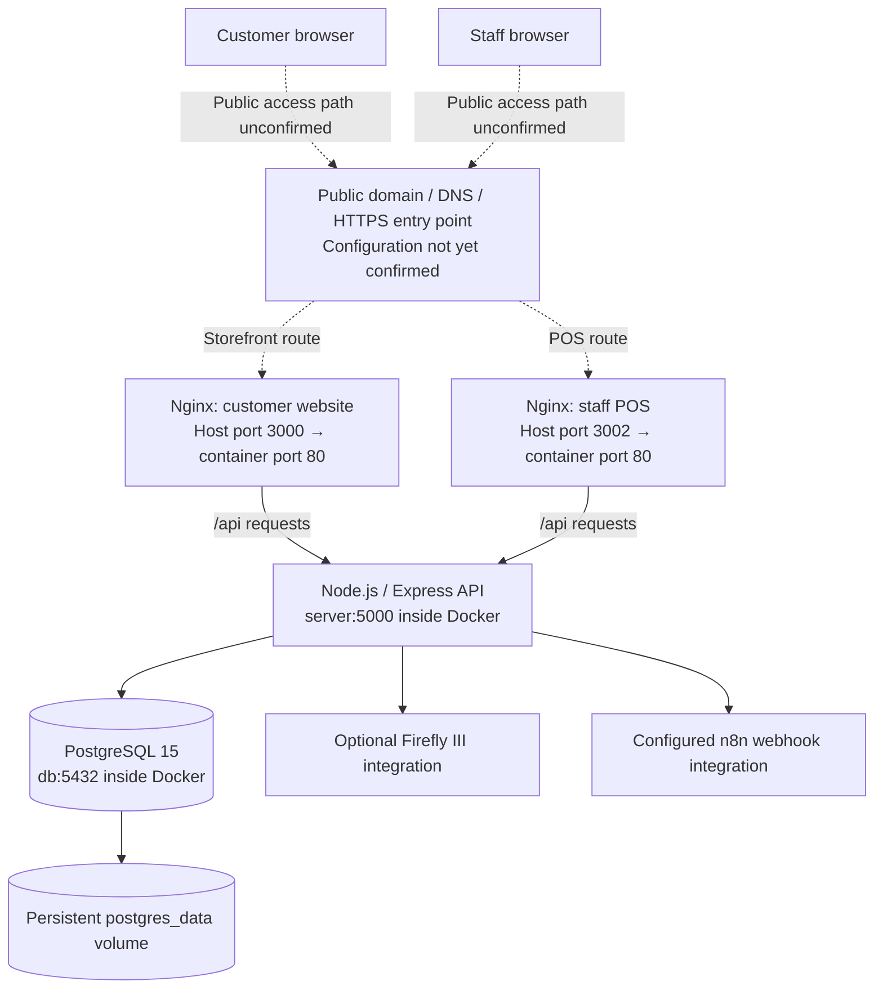

# How the Fortek Website Is Built

This guide explains the technology behind the customer website and staff POS: what runs in the browser, what runs on the server, where information is saved, how access is protected, and how Docker hosts the applications.

Reviewed against the project source, Docker configuration, running container metadata, and local monitoring configuration on **October 29, 2026**. Public domain registration, DNS, and HTTPS routing have not been confirmed. Private environment files and credential values are deliberately excluded.

## 1. The whole system at a glance

Fortek consists of **two browser applications, one shared backend, and one PostgreSQL database**. Docker Compose runs them as four services on the inspected Ubuntu 24.04 host.

| Part | What it does | Main technology | Source location |
| --- | --- | --- | --- |
| Customer website | Product catalog, product details, cart, order-code generation, and a staff administration area | React, React Router, Vite, custom CSS | [`src/`](src/), [`public/`](public/) |
| Staff POS | Register, inventory, suppliers, purchasing, customers, reports, finance, projects, tasks, and account management | React, React Router, Vite, custom CSS | [`pos-system/src/`](pos-system/src/) |
| Backend API | Checks requests and permissions, runs business rules, reads and writes records, and connects to other services | Node.js 22, Express 4 | [`server/`](server/) |
| Database | Stores the shop's inventory, orders, accounts, financial history, and other business records | PostgreSQL 15 | [`server/database.sql`](server/database.sql) and additional SQL files |
| Web serving | Delivers built website files and forwards `/api` requests to the backend | Nginx | [`nginx.conf`](nginx.conf), [`pos-system/nginx.conf`](pos-system/nginx.conf) |
| Hosting and networking | Builds and runs the services together, connects them, and preserves database files | Docker and Docker Compose | [`docker-compose.yml`](docker-compose.yml) |



**Frontend** means the interface in the browser. **Backend** means the server application that handles requests and rules. **API** means the URLs the frontend calls to exchange data. **Database** means the permanent store of business information.

## 2. Frontend: what people see and use

### Customer website

The storefront is a **React single-page application**. Nginx sends the browser HTML, JavaScript, CSS, and images. React builds the interface, and React Router handles navigation between pages without fetching a separate HTML document for every screen.

The main routes in [`src/App.jsx`](src/App.jsx) are:

| URL path | Screen |
| --- | --- |
| `/` | Home |
| `/shop` | Product catalog |
| `/products/:id` | Product details |
| `/cart` | Cart and order-code generation |
| `/about` | Store information and location |
| `/admin` and its child routes | Staff product management and order lookup, guarded by a staff-session check |

React Context manages the cart in [`src/context/CartContext.jsx`](src/context/CartContext.jsx). Browser `localStorage` preserves the cart and saved order-code information when storage is available. These saved values help restore the customer's screen; the backend checks current catalog prices and availability when generating an order.

API calls use the browser's built-in `fetch`, with relative URLs such as `/api/catalog`. See [`src/api/products.js`](src/api/products.js) and [`src/api/orders.js`](src/api/orders.js).

### Staff POS

The POS is a separate React application with its own build and Nginx container. It shares the same backend and database as the storefront.

Its screens include the register, dashboard, inventory, stock counts, suppliers, purchasing, orders, customers, reports, tasks, projects, Financial Manager, activity history, and users. Some screens and actions require staff or administrator roles. Routes are defined in [`pos-system/src/App.jsx`](pos-system/src/App.jsx).

[`pos-system/src/context/AuthContext.jsx`](pos-system/src/context/AuthContext.jsx) checks the current session through `/api/auth/me`, periodically rechecks it, and handles login, logout, and connection recovery. The API enforces permissions independently of what the interface displays.

### Frontend tools and dependencies

Versions below describe the major versions declared in the package manifests. The `package-lock.json` files record exact resolved package versions.

| Tool or library | Where used | Purpose |
| --- | --- | --- |
| React 19 and React DOM 19 | Both frontends | Components, state, and browser rendering |
| React Router DOM 7 | Both frontends | URL routing and navigation |
| Vite 7 and `@vitejs/plugin-react` 5 | Both frontends | Development server, React refresh, and production builds |
| JavaScript and JSX | Both frontends | Application logic and React component markup |
| Custom CSS and CSS variables | Both frontends | Layout, colors, themes, animations, and responsive styling |
| `lucide-react` | POS | Interface icons |
| Recharts 3 | POS | Charts and reports |
| `html2canvas` 1 | POS | Rendering interface content to a canvas/image |
| ESLint 9, React Hooks and React Refresh plugins, `globals`, and React type definitions | Frontend development | Code checks, editor support, and development rules |

The UI uses project CSS files rather than a declared Tailwind or Bootstrap dependency. Shared entry points are [`src/main.jsx`](src/main.jsx) and [`pos-system/src/main.jsx`](pos-system/src/main.jsx).

The project's [responsive UI requirements](AGENTS.md) call for mobile-first layouts, accessible actions at all screen widths, touch-friendly controls, and contained scrolling for wide content.

## 3. Backend: rules and data access

The backend is a **Node.js application using Express**. Its entry point is [`server/index.js`](server/index.js). It accepts HTTP requests, reads JSON or supported uploads, checks authentication and authorization, executes business logic, and returns responses to the browser.

[`server/db.js`](server/db.js) creates a PostgreSQL connection pool using the `pg` library. Queries use SQL directly; the project does not declare an ORM such as Prisma or Sequelize.

### Backend dependencies

| Dependency | Purpose |
| --- | --- |
| Express 4 | HTTP server, routing, and middleware |
| `pg` 8 | PostgreSQL queries, pooled connections, and transactions |
| `dotenv` 16 | Loading runtime configuration from environment files |
| `bcrypt` 6 | Password hashing and password verification |
| `jsonwebtoken` 9 | Signing and validating session tokens |
| Multer 2 | Receiving purchasing document uploads |
| `csv-parser` 3 | Inventory import tooling |
| `cors` 2 | Declared dependency; cross-origin access is not enabled in the inspected API startup code |
| Nodemon 3 | Restarting the backend during development |

Node's built-in modules also provide cryptographic operations, file access, paths, and outgoing HTTP requests. Dependency declarations are in [`server/package.json`](server/package.json).

### Main API areas

| API prefix | Purpose and access |
| --- | --- |
| `/api/catalog` | Public product information and available/unavailable status |
| `/api/product-images` | Public, locally hosted catalog photographs |
| `/api/shop-orders` | Public creation of unpaid website order codes |
| `/api/auth` | Login, logout, session lookup, and administrator account management |
| `/api/products` | Authenticated product information; product changes require staff/admin access |
| `/api/orders` | Authenticated sales, held orders, and order lookup; history/refund/void actions have additional restrictions |
| `/api/inventory`, `/api/suppliers`, `/api/restocking`, `/api/stock-counts` | Inventory and purchasing workflows with staff/admin checks and additional admin-only actions |
| `/api/customers`, `/api/projects`, `/api/tasks` | Customer records, project work, and planning, with action-specific role checks |
| `/api/finance`, `/api/finance/firefly` | Administrator financial management and Firefly connection/sync |
| `/api/activity` | Administrator activity history |
| `/api/health` | Service health, including a database connectivity query |

Route implementations live in [`server/routes/`](server/routes/). Reused business logic lives in [`server/utils/`](server/utils/); middleware handles authentication, activity capture, and sync wake-ups.

## 4. Database: where information is stored

Docker runs **`postgres:15-alpine`**. The application connects to database `fortek_db` through the internal hostname `db`, on port `5432`.

| Data area | Important tables | Schema sources |
| --- | --- | --- |
| Accounts and sessions | `users`, `auth_sessions` | [`database.sql`](server/database.sql) |
| Products, orders, suppliers, customers, movements, and holds | `products`, `orders`, `suppliers`, `customers`, `transactions`, `hold_reservations` | [`database.sql`](server/database.sql) |
| Customer history and request tracking | `customer_order_events`, `customer_requests`, plus customer-related schema extensions | [`customers.sql`](server/customers.sql) |
| Finance | `finance_accounts`, `finance_entries`, `finance_lines`, `finance_debts`, `finance_settlements`, `finance_counts`, `finance_settings` | [`financial.sql`](server/financial.sql) |
| FIFO costing and defective stock | `inventory_batches`, `inventory_allocations`, cost corrections, defects, defect events, and inventory request records | [`fifo.sql`](server/fifo.sql) |
| Purchase orders | `purchase_orders` | [`purchase-orders.sql`](server/purchase-orders.sql) |
| Deliveries, invoices, and supplier payments | Supplier prices, invoices and invoice lines, receipts and receipt lines, advances and events, request tracking | [`restocking.sql`](server/restocking.sql) |
| Purchasing reviews and evidence | Receipt corrections/reviews, cost allocations, supplier claims/events, documents and document links | [`purchasing-review.sql`](server/purchasing-review.sql) |
| Physical stock counts | Sessions, items, attempts, and events | [`stock-counts.sql`](server/stock-counts.sql) |
| Audit history | `activity_history` | [`activity.sql`](server/activity.sql) |
| Projects | Projects, materials, payments, events, and request tracking | [`projects.sql`](server/projects.sql) |
| Planning | `planning_tasks`, `planning_task_requests` | [`tasks.sql`](server/tasks.sql) |
| Firefly connection and synchronization | Connection settings, account mappings, imports, exports, ignored records, and outbox | [`firefly.sql`](server/firefly.sql) |

The backend applies schema files and initialization helpers before it starts listening. It exits if database initialization fails. [`server/index.js`](server/index.js) shows the actual initialization order, including helpers that extend the base schema.

### Data integrity

Related records use foreign keys, uniqueness rules, indexes, and constraints. Critical sale, inventory, and finance operations use database transactions and locks so related changes succeed or roll back together. Request keys help prevent supported retries from recording the same operation twice.

Financial ledger amounts use integer centavos (`BIGINT` in PostgreSQL and `BigInt` in backend calculations). Posted financial entries must balance; database triggers prevent rewriting posted journals and require corrections through reversals. FIFO means **first in, first out**: inventory batches track which purchase costs belong to units sold.

### Persistent storage and files

The database directory `/var/lib/postgresql/data` is mounted to the Compose volume `postgres_data`. The observed Docker volume name is `fortek-website_postgres_data`. Its contents survive replacement of the database container when the volume is retained.

Product photographs are application files in `server/public/product-images`, served through `/api/product-images`. Purchasing evidence is different: uploaded PDFs/images are stored as database bytes in `purchase_documents`, with metadata, SHA-256 hashes, and links to purchasing records.

Browser cart storage is local to that browser. It is separate from the shop database and is not a backup of business records.

## 5. How common actions move through the system

### Viewing products

1. The browser loads the storefront from Nginx.
2. React requests `/api/catalog`.
3. Nginx forwards the request to `server:5000` inside Docker.
4. Express queries PostgreSQL for active, undeleted products and availability after held reservations.
5. The API returns public catalog fields; React displays the results. Public catalog responses omit supplier details, purchase costs, and exact stock quantities.

### Generating a website order code

1. The customer selects products and quantities in the cart.
2. The browser posts product IDs, quantities, and a retry key to `/api/shop-orders`.
3. The backend checks current prices, active products, and available stock.
4. It saves an unpaid preparation note and returns an `FTK-…` code.
5. The customer sends the code through Messenger for store confirmation.

Generating this code **does not reserve stock, deduct inventory, or record a paid sale**. Staff business-order lookup remains authenticated. The current implementation is in [`server/routes/shop-orders.js`](server/routes/shop-orders.js); an older description in [`server/SECURITY.md`](server/SECURITY.md) says anonymous ordering is disabled and no longer matches this route.

### Completing a POS sale

The staff browser sends the sale with its session cookie. The backend validates the session and permissions, checks inventory and existing reservations, records the order and stock movement, allocates FIFO costs, and posts the financial entry inside a transaction. After a successful save, configured integrations can be notified. See [`server/routes/orders.js`](server/routes/orders.js).

Payment methods such as cash, GCash, Maya, bank, and card are represented in the financial workflow. The inspected code does not establish an online payment gateway that charges customers; recording a payment method is separate from collecting money through a provider.

## 6. Security: how access and records are protected

| Control | Implementation |
| --- | --- |
| Password storage | Passwords are hashed with bcrypt. New account passwords must be between 12 and 72 UTF-8 bytes. |
| Session authentication | Signed JWTs identify a user and server-side session. Tokens expire after eight hours. Every authenticated request checks the current database account, role, and unexpired session. |
| Browser session cookie | The applications use `pos_session`, an `HttpOnly`, `SameSite=Strict` cookie scoped to `/api`. It requires HTTPS outside localhost/127.0.0.1. |
| Logout and access changes | Logout deletes the session; subsequent requests check current database state, so account deletion and role changes apply to API access. |
| Role permissions | `cashier`, `staff`, and `admin` permissions are enforced on the backend. Frontend route guards also guide navigation. |
| Request protection | Login and cookie-authenticated mutations require `X-POS-Request: 1`. Browser helpers add it to same-origin API calls; cross-origin API access is not enabled. |
| Login limiting | In-memory counters limit attempts per username and backend peer within a 15-minute window. These counters reset when the backend restarts. |
| Signing secret | Startup rejects a missing, short, or known-default `JWT_SECRET`; at least 32 bytes are required. |
| SQL and business validation | Parameterized queries separate values from SQL; routes validate request fields, quantities, states, and action permissions. |
| Upload handling | Purchasing uploads are limited to 5 MB and checked for supported PDF/PNG/JPEG/WebP signatures. Downloads use attachment responses, `nosniff`, no-store caching, and a sandbox policy. |
| API response settings | Express's identifying header is disabled, `X-Content-Type-Options: nosniff` is set, and protected route groups use no-store caching. |
| Internal access | API and database host ports bind to loopback. Frontends connect to the API over the Docker network. |
| History integrity | Financial constraints and immutable journal triggers preserve posted records; activity history records business actions. |

Authentication code: [`server/middleware/auth.js`](server/middleware/auth.js), [`server/routes/auth.js`](server/routes/auth.js). Browser request helpers: [`src/api-security.js`](src/api-security.js), [`pos-system/src/api-security.js`](pos-system/src/api-security.js).

The browsers do not save login tokens in `localStorage`. The backend also accepts a supported Bearer token, but the browser helpers remove Authorization headers from same-origin API calls and use the session cookie.

### Runtime configuration and secrets

Compose loads backend settings from `server/.env` and `server/.env.security`. The database also loads `server/.env.security`. The private security file is ignored by Git and excluded from Docker build contexts.

| Variable | Purpose |
| --- | --- |
| `POSTGRES_USER`, `POSTGRES_PASSWORD`, `POSTGRES_DB` | Database login and database selection |
| `DB_HOST`, `DB_PORT` | Database server address and port |
| `PORT` | Express listening port, defaulting to `5000` |
| `JWT_SECRET` | Session signing and verification |
| `FIREFLY_ENCRYPTION_KEY` | Optional dedicated secret for Firefly token encryption; otherwise the implementation derives a key from `JWT_SECRET` |
| `N8N_WEBHOOK_URL` | Destination for configured automation events |
| `VITE_PORT` | Optional storefront development-port override |

The code contains database connection fallbacks; the deployed connection should obtain its actual password from private runtime configuration. Credential values are not part of this guide.

These controls describe the inspected application. Public HTTPS termination, firewall rules, and any domain-provider security settings are outside the verified configuration below.

## 7. Hosting: how the applications run

### Docker services and ports

[`docker-compose.yml`](docker-compose.yml) defines a bridge network named `fortek-network` and these services. The running container port mappings matched this configuration when inspected.

| Service | Container software | Host mapping | What connects to it |
| --- | --- | --- | --- |
| `client` | Nginx serving the built storefront | `3000 → 80`, bound to all host interfaces | Browsers on reachable networks or an external proxy/tunnel |
| `pos` | Nginx serving the built POS | `3002 → 80`, bound to all host interfaces | Staff browsers on reachable networks or an external proxy/tunnel |
| `server` | Node.js 22 / Express | `127.0.0.1:5001 → 5000` | Host-local tools; frontends use internal `server:5000` |
| `db` | PostgreSQL 15 Alpine | `127.0.0.1:5434 → 5432` | Host-local database tools; backend uses internal `db:5432` |

Published frontend ports do not by themselves establish public Internet access; reachability also depends on the machine's network and any external routing.

### How a production build works

Both frontend Dockerfiles use two stages:

1. A `node:22-alpine` stage installs dependencies and runs `npm run build`. Vite produces a `dist/` directory containing browser-ready files.
2. An `nginx:alpine` stage copies those files into `/usr/share/nginx/html` and serves them on container port `80`.

The backend image uses `node:22-alpine`, installs server dependencies, and runs `npm start`, which starts `node index.js`. PostgreSQL uses its existing upstream Docker image.

Build definitions: [`Dockerfile`](Dockerfile), [`pos-system/Dockerfile`](pos-system/Dockerfile), [`server/Dockerfile`](server/Dockerfile).

Nginx returns `index.html` for frontend routes so refreshing a route such as `/shop` or `/inventory` still loads React. Requests beginning with `/api` are forwarded to Express. Docker DNS resolves the backend service name; the Nginx configuration refreshes that resolution after container replacements. Nginx also forwards the incoming host and forwarded-protocol header.

### Starting or updating the deployment

With Docker installed and the private runtime files provisioned, the deployment command from the project root is:

```bash
docker compose up -d --build
```

This builds images and starts or replaces services in the background. It is an operational command for a maintenance window, not something this documentation change executes. The database volume is retained across normal container replacement. `docker compose down -v` would remove Compose-managed data volumes and must not be used to preserve the shop's database.

The backend waits for a healthy database. Services have health checks and `restart: always`. That restart policy handles process exits; a container becoming unhealthy alone does not trigger a Docker restart.

### Monitoring and recovery

[`scripts/monitor.sh`](scripts/monitor.sh) checks the storefront at port `3000`, POS at `3002`, and API health at `5001`. It retries failed checks and restarts affected services. An installed user cron entry runs this script **every minute** on the inspected machine. Monitoring writes under `logs/` and uses a lock to avoid overlapping with a cooperating deployment.

The API health endpoint runs `SELECT 1`, so it checks database access as well as the backend process. Local cron logs are separate from Docker container logs.

The persistent database volume is confirmed. An automated database-backup schedule, off-machine backup destination, and restore procedure were not established by the configuration inspected for this guide. Preserving a volume and keeping an independent backup are separate operations.

## 8. Domain, DNS, and HTTPS

A **domain** is the public name people type. **DNS** directs that name toward a server or provider. **Hosting** is where the running website lives. **HTTPS** encrypts the browser connection and requires a certificate at the point handling that connection.

The Docker stack confirms the local hosting side, but it does not define the public entry point. The frontend Nginx containers listen on HTTP port `80`; their checked configurations do not manage HTTPS certificates.

| Detail | Current evidence |
| --- | --- |
| Public storefront hostname | Not confirmed |
| Public POS hostname or path | Not confirmed |
| Domain registrar and renewal owner | Not confirmed |
| DNS provider and active records | Not confirmed |
| Internet-facing server, hosting company, or router/tunnel | Not confirmed |
| HTTPS certificate issuer, termination location, and renewal method | Not confirmed |
| Local storefront destination | Host port `3000` |
| Local POS destination | Host port `3002` |

The machine also has an active Apache service, but its inspected enabled site is a default document-root configuration. That does not establish that Apache publishes Fortek. No Fortek public-domain mapping was identified in the repository or inspected enabled proxy configuration.

A public setup would need to route the storefront address to port `3000` and the POS address to port `3002`, through whichever proxy, tunnel, or network arrangement the owner uses. This is the connection that still needs to be documented; this guide does not assume Cloudflare or another provider is in use.

The repository names `fireflyiii.forgroup.space` for the finance integration and an `n8n.forgroup.space` webhook host. Those are **integration destinations**, not evidence of the storefront's public address.

When domain access details become available, record the public addresses, registrar, DNS provider, relevant records, routing destination, and certificate-renewal arrangement in this section. Leave passwords, API keys, and tunnel tokens in private configuration.

## 9. External services

| Service | How Fortek uses it | Source |
| --- | --- | --- |
| Facebook / Messenger | Customers contact the store and send generated order codes using links to the Fortek page | [`src/pages/Home.jsx`](src/pages/Home.jsx), [`src/components/Footer.jsx`](src/components/Footer.jsx) |
| Google Maps | Embedded location maps and map links | [`src/pages/Home.jsx`](src/pages/Home.jsx), [`src/pages/About.jsx`](src/pages/About.jsx) |
| n8n | Backend posts events such as new orders, refunds, and stock updates to the configured webhook | [`server/utils/webhook.js`](server/utils/webhook.js) |
| Firefly III / Waterfly connection | Optional administrator-configured money-account synchronization | [`server/utils/firefly.js`](server/utils/firefly.js), [`server/FIREFLY.md`](server/FIREFLY.md) |

The n8n URL in Compose currently uses a test-webhook path; the configuration alone does not verify that an n8n workflow is listening or completing automation.

Firefly access tokens are encrypted in the database with AES-256-GCM and a derived key. The backend worker can sync on startup, after relevant successful saves, and through periodic checks when the connection is configured and enabled. Firefly connection code being present does not establish that an authenticated connection is active.

## 10. Development and verification tools

The repository uses npm and keeps separate manifests and lockfiles for the storefront, POS, and backend.

| Component | Working directory | Development command | Build or start command |
| --- | --- | --- | --- |
| Storefront | Project root | `npm run dev` | `npm run build` |
| POS | `pos-system/` | `npm run dev` | `npm run build` |
| Backend | `server/` | `npm run dev` | `npm start` |

The actual Vite configurations use storefront development port **6173** by default and POS development port **6174**. Both proxy `/api` to `http://localhost:5001`, matching the Docker backend's host port. Running the backend directly uses port **5000** by default, so a direct-development setup needs matching proxy/port settings. Some older README setup examples use different ports; use [`vite.config.js`](vite.config.js), [`pos-system/vite.config.js`](pos-system/vite.config.js), and Compose as the reference.

Frontend ESLint commands are available through `npm run lint` in each frontend directory. The root also provides `npm run check:dialogs`. Node-based tests cover business behavior, and Playwright-based scripts exercise browser workflows and responsive layouts in [`tests/`](tests/) and [`pos-system/tests/`](pos-system/tests/). Backend tests are in [`server/tests/`](server/tests/).

Database integration fixtures have their own disposable-database requirements. They should be run according to their setup rather than pointed at the shop's live database. This guide documents the available checks; it does not report that all tests were executed for this documentation-only change.

## 11. Where to look when changing something

| Change | Main files or folders |
| --- | --- |
| Customer page content and layout | [`src/pages/`](src/pages/), [`src/components/`](src/components/), frontend CSS |
| POS pages and navigation | [`pos-system/src/pages/`](pos-system/src/pages/), [`pos-system/src/components/`](pos-system/src/components/), [`pos-system/src/layouts/`](pos-system/src/layouts/) |
| Cart behavior | [`src/context/CartContext.jsx`](src/context/CartContext.jsx), [`src/utils/store.js`](src/utils/store.js) |
| Browser API and session handling | Both `api-security.js` files, storefront API modules, POS auth context |
| Login, accounts, and permissions | [`server/routes/auth.js`](server/routes/auth.js), [`server/middleware/auth.js`](server/middleware/auth.js), individual routes |
| Backend rules | [`server/routes/`](server/routes/), [`server/utils/`](server/utils/) |
| Tables and constraints | [`server/`](server/) SQL files and startup initialization helpers |
| Container builds, ports, and persistent storage | The three Dockerfiles and [`docker-compose.yml`](docker-compose.yml) |
| Frontend serving and API forwarding | [`nginx.conf`](nginx.conf), [`pos-system/nginx.conf`](pos-system/nginx.conf) |
| Uptime checks | [`scripts/monitor.sh`](scripts/monitor.sh) and the installed host cron entry |
| Public domain and HTTPS | External routing/provider configuration, still to be identified |

For detailed business workflows, see [restocking and suppliers](docs/restocking-and-suppliers.md), [purchasing reviews and evidence](docs/purchasing-reviews-and-claims.md), [FIFO inventory](server/FIFO.md), [Financial Manager](server/FINANCIAL_MANAGER.md), [stock counts](server/STOCK_COUNTS.md), [projects](server/PROJECTS.md), and [tasks](server/TASKS.md).
