# DentaBook

**Book your smile, know your cost.**

DentaBook connects patients with dental clinics. Patients can explore services and estimated costs, ask their chosen clinic a question, request appointments, and follow their care. Clinics manage their services, dentists, schedules, patient concerns, and bookings. Platform administrators review clinic registrations through a separate administration website.

**Live website:** [Open DentaBook](https://dentabook.forgroup.space) · **Guide updated:** 8 November 2026

## Choose your guide

| I am a… | Start here | Sign in |
| --- | --- | --- |
| Patient | [Patient guide](#patient-guide) | [Patient sign-in](https://dentabook.forgroup.space/patient/sign-in) |
| Clinic owner, staff member, or dentist | [Clinic guide](#clinic-guide) | [Clinic sign-in](https://dentabook.forgroup.space/clinic/sign-in) |
| Platform administrator | [Administrator guide](#administrator-guide) | [Administrator sign-in](https://dentabook-admin.forgroup.space/admin/sign-in) |

You can browse clinics, services, and the cost calculator without an account. Booking, clinic questions, personal records, and notifications require patient sign-in.

**Coverage:** the guides below include public discovery/calculator, every patient account and visit action, all clinic workspace sections, dentist/staff access, concern moderation, notifications, and administrator sign-in/review. Features not yet implemented are identified explicitly rather than given invented steps.

**About the pictures:** these are screenshots of the actual website interface with clearly labelled, test-only records. Example names, prices, addresses, dates, and messages illustrate the controls; they are not real clinics, credentials, prices, patients, or appointments. No customer records or passwords appear in the guide. Click an image to view it at full size. On a phone, clinic tools are inside the clinic navigation menu.

## Patient guide

### 1. Find a clinic and explore its services

1. Open [DentaBook](https://dentabook.forgroup.space) and choose **Find a clinic**.
2. Search by clinic, location, dentist, or treatment. Open a clinic to see its published information, services, and dentists.
3. Use the directory location/service filters and **Reset filters** to reset a search. Open clinic information tabs to read the available background, contact, services and dentist information.
4. Use **Estimate my cost** or **Cost calculator**, select a clinic, and tick/untick one or more treatments to update the estimated total. **View clinic contact details** returns to that clinic. Public **Services** and **About us** explain the published service catalog and platform. If no records exist, use the honest empty state; for a loading error, use the displayed retry action. Final treatment and cost depend on the clinic's assessment.

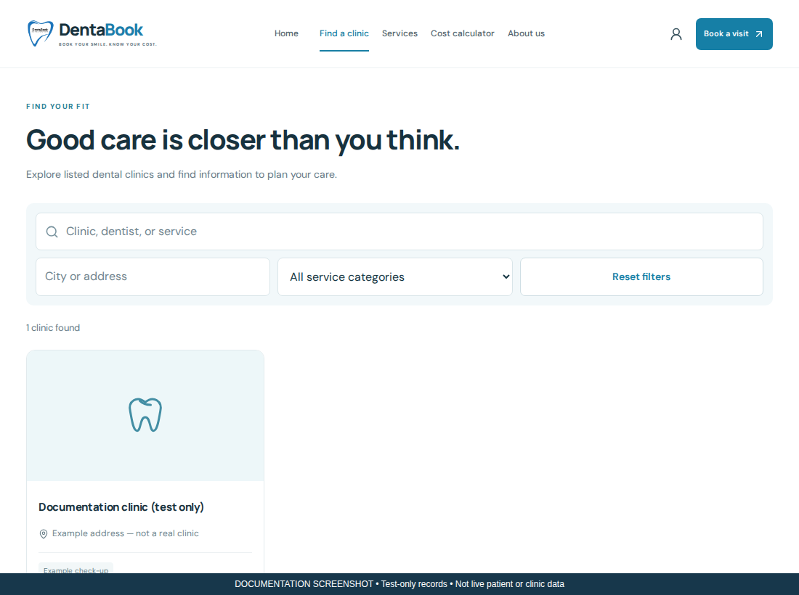

### 2. Create your patient account and sign in

1. Open [Patient registration](https://dentabook.forgroup.space/patient/register).
2. Enter your name, email, phone number, password, and matching password confirmation. Follow the password requirements shown on the form.
3. Password fields start hidden. Use **Show** to see a field and **Hide** to mask it again; each field toggles independently. Submit the form, continue to [Patient sign-in](https://dentabook.forgroup.space/patient/sign-in), and sign in with your own account.
4. When sign-in was requested while opening a private page, DentaBook returns you to that page.

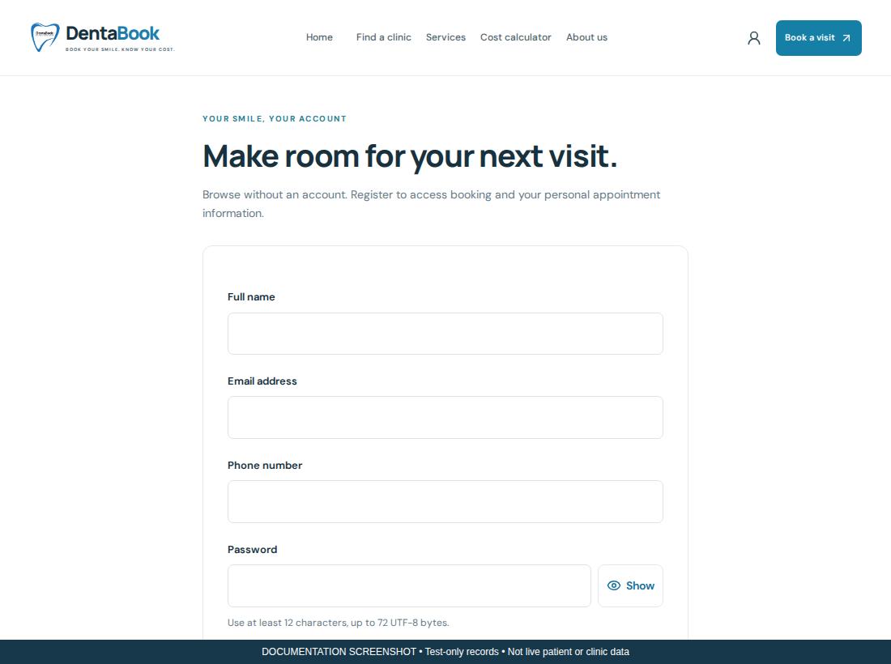

### 3. Ask your chosen clinic a question — optional

1. Open the clinic's profile and choose **Ask about a concern**, or open [My clinic concerns](https://dentabook.forgroup.space/patient/concerns).
2. Choose the clinic you want to contact. Describe what you are feeling, when it started if relevant, and why you would like a check-up.
3. Choose **Send concern**. The concern goes only to that clinic. It shows **Waiting for a dentist** until a dentist accommodates it.
4. Once assigned, the dentist's name appears. Open the conversation to read notes and use **Send reply** to continue.

There is one open conversation per patient per clinic. If you start another concern with the same clinic, continue the existing conversation; your additional draft is kept in its reply field. New concerns are limited to three per 24 hours, with five messages per minute per author. **A concern conversation does not reserve a time or confirm an appointment.**

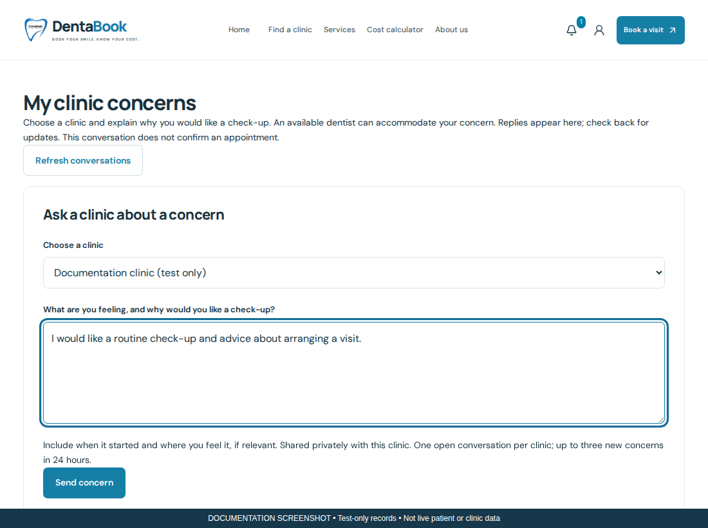

### 4. Request an appointment

1. Choose **Request an appointment** on a clinic profile or open [Book a visit](https://dentabook.forgroup.space/patient/book).
2. Select the clinic, treatment, dentist, visit date, and an available time.
3. Check the estimated cost and contact details. The contact email may differ from your account email; changing it here does not change your account.
4. Answer the clinic's required intake questions, if enabled, and agree to share those answers.
5. Review the details and choose **Send appointment request**. Read and retain the saved appointment reference.

The first status is **pending review**, not confirmed. One request covers one treatment and dentist. Times use Philippine time; availability can change before the request is saved. If a selected time is taken, refresh the available times and choose another.

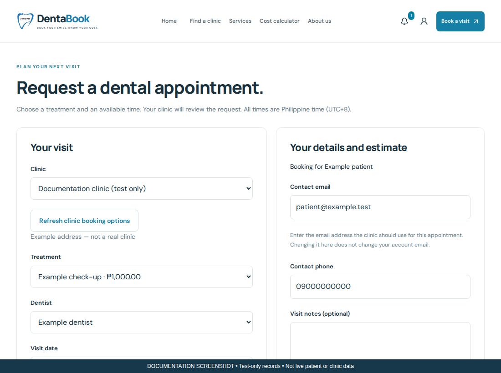

### 5. Track the request and follow the clinic's payment instructions

1. Open [My appointments](https://dentabook.forgroup.space/patient/appointments). Use **Refresh appointments** to see the clinic's saved decision and notes. This page currently shows your latest 50 records; full older-history pagination remains planned.
2. If accepted, open **Deposit & payment details**. Choose only a payment method enabled by that clinic.
3. For **GCash**, review the deposit and terms, transfer in your own GCash app to the clinic's displayed account, and submit the transaction reference. The clinic must check the actual transfer before recording payment.
4. For **Pay at clinic**, choose that option and wait for the clinic's confirmation. A confirmed Pay at clinic visit is still **unpaid**.
5. Check the appointment status again. **Accepted** and **confirmed** are different stages.

Use **Manage appointment** for cancellation or rescheduling when the clinic's policy permits it. Read the policy and notice deadline. A reschedule request keeps the original visit until the replacement is approved; cancellation does not automatically refund money. Open **Intake & clinic follow-up** for additional clinic questions.

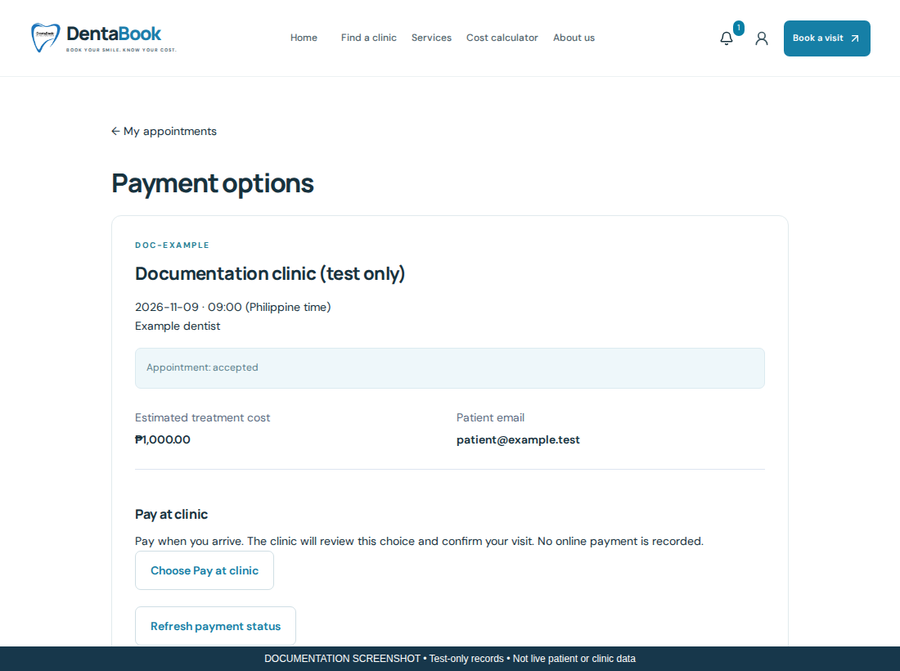

### 6. Read your notifications

1. Choose the **bell** in the header or open [Notifications](https://dentabook.forgroup.space/patient/notifications).
2. Read concern replies and assignment/status updates. Choose **Open concern** to return to the conversation.
3. Use **Mark as read**, **Mark all as read**, or **Refresh notifications**. Read status stays saved after you sign out.

Notifications refresh every 30 seconds while the page is visible and on focus. These notifications are inside DentaBook; email, SMS, device push, and appointment reminders are not enabled.

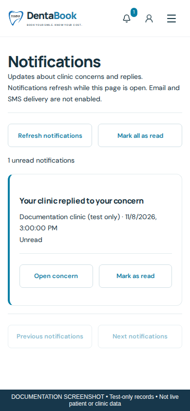

### 7. Leave private feedback after your visit

1. After the clinic records your confirmed visit as completed, open **My appointments**.
2. In **Your visit feedback**, choose a rating and optionally write a comment.
3. Choose **Submit feedback** once. Feedback is private to you and authorized clinic staff; it is not a public rating.

You can also open **My account** to edit your name/phone or change your password using your current password. A password change signs out all sessions. Existing appointment contact details stay as originally booked.

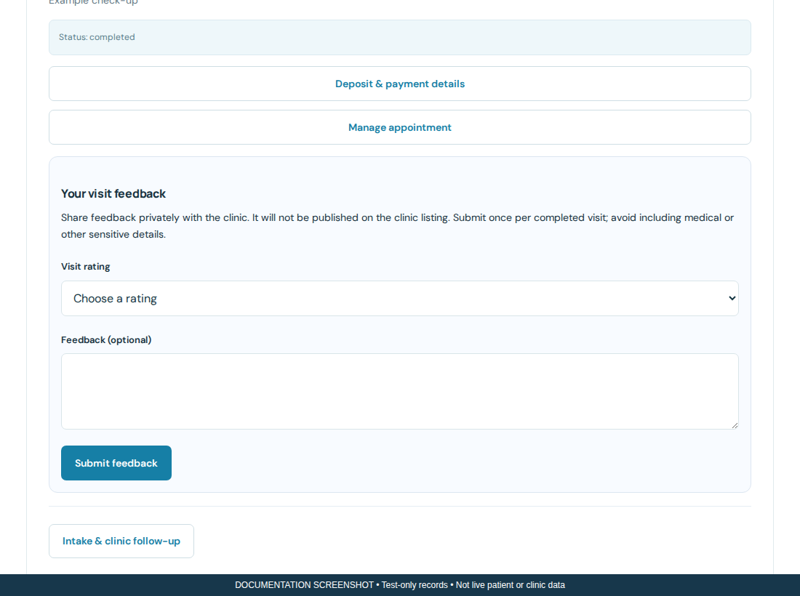

### 8. Update your profile and password

1. Open **My account** and edit **Full name** or **Phone number**. Choose **Save profile** and check the saved message.
2. To change your password, enter **Current password**, **New password**, and **Confirm new password**. Each has its own **Show**/**Hide** button. Choose **Save new password and sign out**.
3. Sign in again with the new password. All existing sessions are revoked; previously booked contact details remain unchanged.
4. Use **Sign out** when finished, especially on a shared device. Account-email editing, email verification, and self-service password recovery are not enabled; contact the operator for account-access assistance.

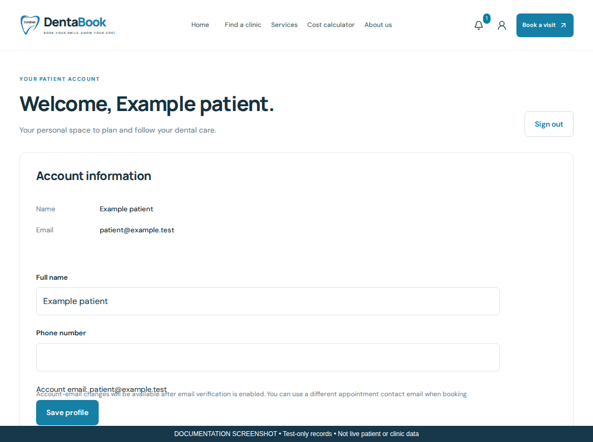

### 9. View and print a verified deposit receipt

1. Open **My appointments → Deposit & payment details** for the relevant visit.
2. After the clinic verifies an actual GCash deposit, open the receipt section. If it cannot load, use **Retry receipt**.
3. Choose **Print receipt** to print or save through your browser's print dialog. Keep the receipt/reference for later enquiries.

A submitted reference alone is not a verified payment. Pay at clinic confirmation remains unpaid and does not create a payment receipt. Receipts and payment records are retained if an appointment is cancelled; refund handling requires clinic review.

### 10. Cancel an eligible appointment

1. Open **My appointments → Manage appointment** for the correct visit. Read the clinic's policy and notice deadline.
2. If available, choose **Cancel appointment**. Enter **Reason for change**.
3. Review the effect and choose **Confirm cancellation**, or choose **Keep current appointment** to back out before submission.
4. Read the updated status and **Change history**. Contact the clinic for payment/refund follow-up if indicated.

If the action is unavailable or the deadline has passed, contact the clinic. Cancellation releases the reserved time; it does not automatically return money.

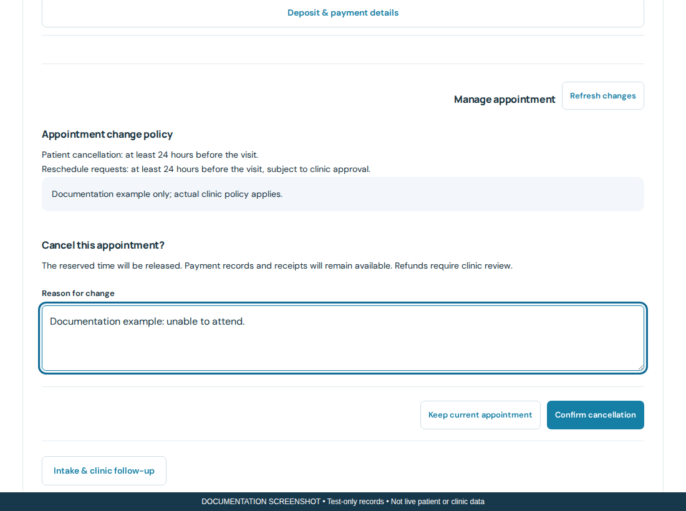

### 11. Request another time or withdraw the request

1. Open **My appointments → Manage appointment → Request reschedule**, when permitted by the policy.
2. Choose **Replacement date**, select an available replacement time, and enter **Reason for change**. Use **Refresh replacement times** if needed.
3. Choose **Send reschedule request**. The original visit remains reserved; the requested time is not held until clinic approval.
4. Check **Change history** for approval/decline and any decision note. A conflict or decline leaves the original visit intact.
5. To stop a pending request, choose **Withdraw reschedule request** in its history entry. This keeps the original appointment.

Rescheduling keeps the same clinic, dentist, treatment, original estimate/duration, and payment records. It does not automatically start a different treatment or change clinics.

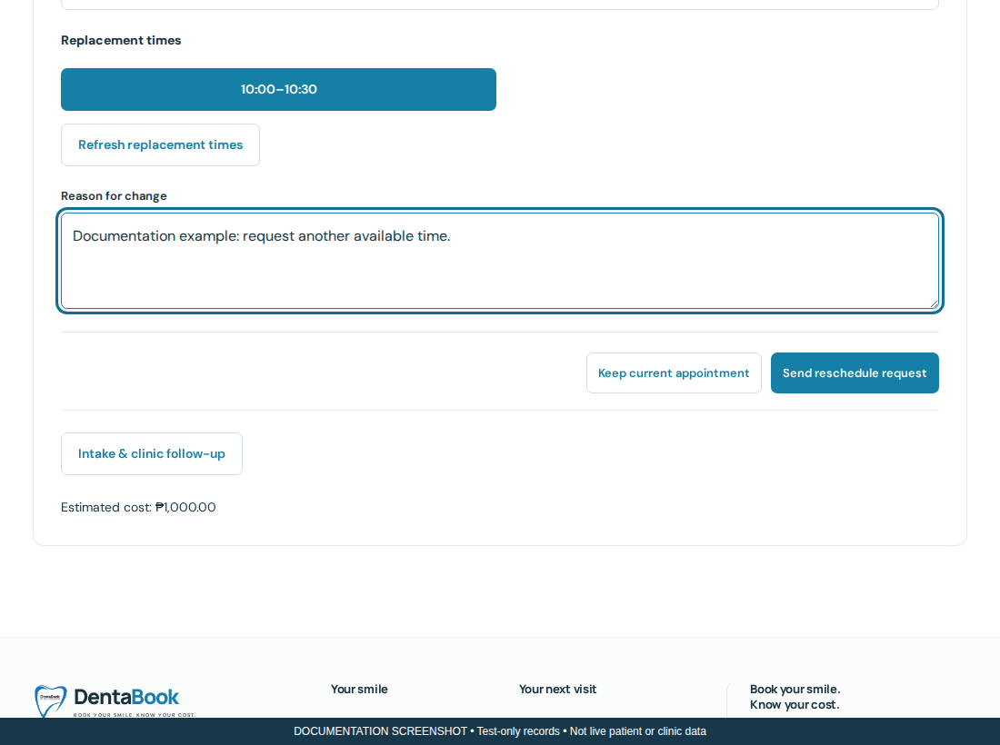

### 12. Answer appointment intake and follow-up questions

1. Complete the applicable **Clinic questions before booking** during the booking form. Required answers and explicit consent must be provided before sending the request.
2. For an existing visit, open **My appointments → Intake & clinic follow-up**. Read the clinic's purpose and record-retention statements.
3. If additional intake is available, answer the current questions, agree to share the answers, and choose **Save intake answers**. If questions changed, reload and answer the current version.
4. Expand **Latest submission** or **Previous submission** to read saved question/answer snapshots.
5. Under **Clinic follow-up**, answer an unanswered information request in **Your response**, then choose **Send response**. Saved responses remain visible; a reply does not change appointment/payment status.

For notifications, **Previous notifications** and **Next notifications** reach older pages. A notification count/read action applies to your own account, not another person's inbox. Appointment follow-up is checked in the appointment itself; the current notification tabs cover concern conversations, not all appointment events.

## Clinic guide

### 1. Register the clinic and wait for approval

1. An authorized clinic representative opens [Clinic registration](https://dentabook.forgroup.space/clinic/register).
2. Enter the account holder's details and the clinic's real name, address, public contacts, and registration/license reference. **Show**/**Hide** works independently beside password and confirmation fields.
3. Submit the application. Sign in at [Clinic sign-in](https://dentabook.forgroup.space/clinic/sign-in) to check its status and review notes.
4. Wait for administrator approval before accessing clinic management. A submitted application is not automatically approved or published.

Invited staff and dentists should accept the owner's private invitation instead of registering another clinic.

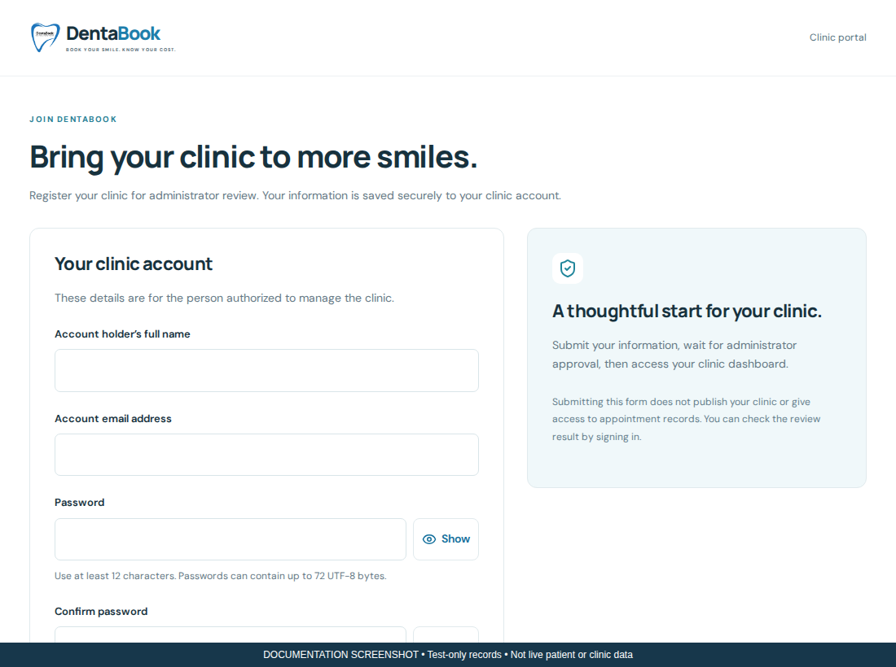

### 2. Sign in and complete your booking setup

1. After approval, sign in and open **Overview**.
2. Follow the booking setup checklist. On phones, expand the clinic navigation menu to reach each tool.
3. Open **Clinic profile** and save your actual background, location, and contact information.
4. If an operator-provisioned platform-owner account shows a **Clinic** selector, choose the intended clinic before using its tools. Ordinary clinic members are fixed to their own clinic and do not receive this selector.

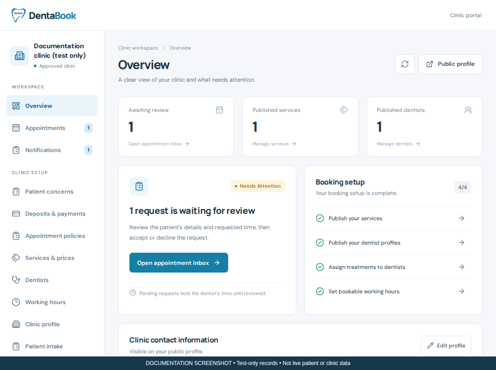

### 3. Add services and assign dentists

1. Open **Services & prices → Add a service**. Enter the treatment name, category, description, estimated price, and duration; publish it when ready.
2. Open **Dentists → Add a dentist**, enter accurate profile information, and select that dentist's treatments. Existing profiles can be edited.
3. Publish the dentist when the information is ready. A public dentist profile by itself does not create sign-in access.

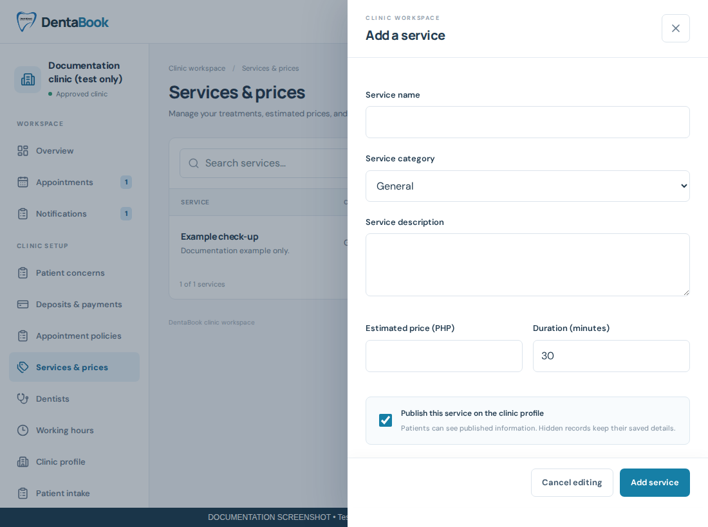

See dentist profiles and treatment assignment

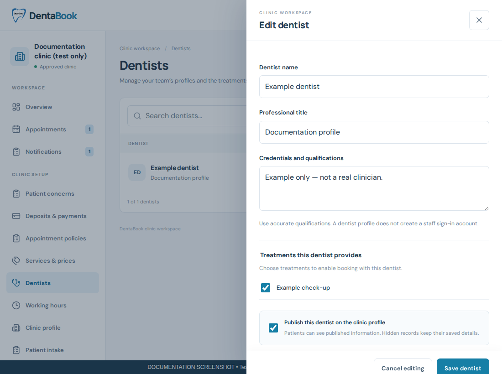

### 4. Set working hours, payment options, and clinic policies

1. Open **Working hours → Add working hours**. Select dentists and days; use **Monday–Friday** or **Every day** where appropriate.
2. Enter the start/end times. Use **Add split shift** for a lunch break or other gap, review the preview, then **Save working hours**.
3. Open **Deposits & payments** and explicitly enable the methods your clinic accepts. Configure actual GCash recipient/deposit terms if using GCash, or enable Pay at clinic.
4. Open **Appointment policies** to configure patient cancellation/rescheduling permissions, notice deadlines, and terms.
5. Under **Patient intake**, write the questions, explain purpose/retention, choose required/optional answers, and enable intake when ready.

Working hours recur weekly. Schedule edits do not move existing appointments; conflicting batches are rejected rather than partly saved. Payment methods and patient change actions remain unavailable until the clinic enables them.

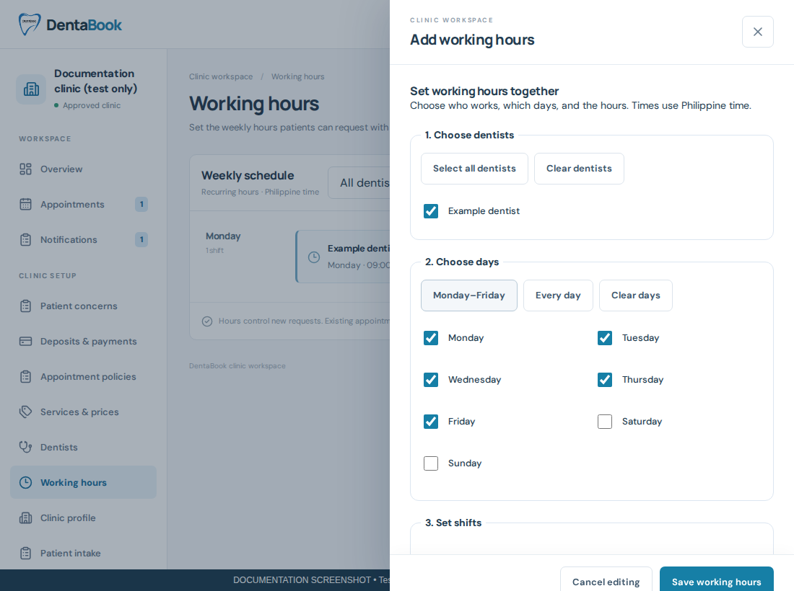

### 5. Review appointments, follow up, and verify payment

1. Open **Appointments**. Choose a status or search the loaded requests.
2. Open a request and read the visit details, contact information, intake answers, and notes.
3. Choose **Accept request** or **Decline request**, add the appropriate note/reason, and confirm the decision. Use private follow-up questions when information is missing.
4. After acceptance, review the patient's payment choice under **Deposits & payments**. Match actual GCash funds, reference, and exact amount before verifying. Review Pay at clinic separately; confirmation does not record payment received.
5. Review cancellation/rescheduling actions under the saved policy. Resolve conflicts before approving another time.

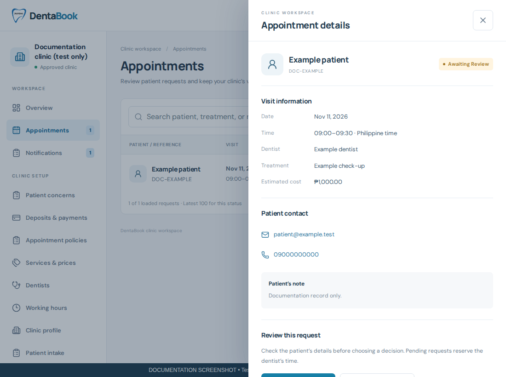

### 6. Accommodate concerns and use notifications

1. Open **Patient concerns** to find patients who chose your clinic.
2. A linked dentist opens an unassigned conversation and selects **Accommodate patient**. The first successful claim assigns that dentist; simply opening the conversation does not.
3. Read the concern and send patient-visible replies. **Notifications** shows new concerns, patient replies, and eligible updates, with individual read status.
4. Staff may close, mark spam, or reopen concerns. Owners/managers can reassign to an active dentist or apply/remove a clinic-specific 24-hour restriction, with a recorded reason.

Dentists see unassigned concerns and their own assigned conversations. Appointment assignment/confirmation remains a separate booking process.

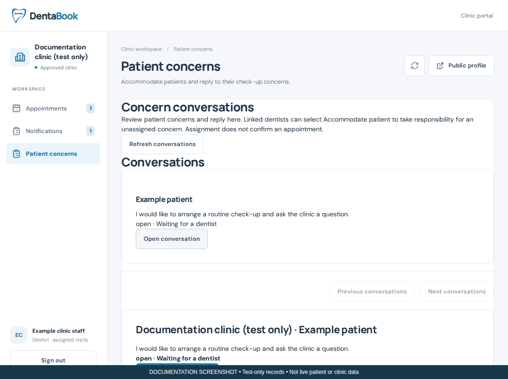

### 7. Give each team member the right access

1. The owner opens **Staff access**, enters the person's email, and chooses **Manager**, **Appointment staff**, or **Dentist**.
2. For dentist access, link an active dentist profile from this clinic.
3. Create the invitation and share its private link directly with the intended person. It expires after 48 hours and can be accepted once; do not publish invitation links or passwords.
4. The recipient accepts the invitation and uses **Clinic sign-in**. Owners can change roles, reassign linked dentist access, revoke membership, and inspect access history.

Managers handle clinic setup and payments but cannot manage staff. Appointment staff handle appointments, hours, concerns, and notifications. Dentists are limited to their assigned appointments/concerns and the unassigned concern queue.

### 8. Record completed visits

After a confirmed visit's scheduled end, open its details, resolve any pending appointment changes, confirm that the visit took place, and choose **Mark visit completed**. The system records who completed it and when. Completion does not collect money or change payment status. The patient can then submit private feedback, visible in the visit details.

### 9. Maintain the clinic profile and published catalog

1. Open **Clinic profile**, edit the clinic name, description, address, public phone/email, and choose **Save clinic profile**. The account sign-in email is separate.
2. In **Services & prices** or **Dentists**, search the saved list and use the **Publication status** filter to find published/hidden entries.
3. Choose the row's edit action, update the fields/treatment assignments, and save. Use the publication checkbox to hide or republish the record.
4. Use **View public clinic profile** / **Public profile** to review what patients can see. Hidden services/dentists do not become new booking choices; saved appointment information is retained.
5. Use **Cancel editing**, **Close panel**, or Escape to dismiss an idle editor. If saving fails, correct/retry the retained fields rather than assuming the change was saved.

### 10. Edit or remove working hours

1. Open **Working hours** and optionally filter by dentist. Use the grouped weekday cards to find the saved shift.
2. Choose **Edit hours**, select its day/start/end, check the **Update preview**, and choose **Update working hours**.
3. To remove that recurring shift, choose **Remove hours**. Existing appointments keep their saved times; arrange any affected visits separately.
4. When adding a batch, use **Select all dentists**, **Clear dentists**, **Monday–Friday**, **Every day**, or **Clear days** as needed. **Add split shift** adds a separate shift; remove an unsaved shift with its removal action before saving.

Overlapping batches fail as a whole. Identical saved shifts are retained on retry. These controls are recurring weekly hours; date-specific holidays/leave and automatic changes to existing visits are not implemented.

### 11. Configure and review payments separately from appointments

1. An owner/manager opens **Deposits & payments**. Select **Accept GCash deposits** and/or **Allow Pay at clinic** according to actual clinic practice.
2. For GCash, enter the clinic's actual **GCash account name**, **GCash mobile number**, explicit **Deposit percentage (%)**, and **Cancellation and refund terms**. Choose **Save payment options**.
3. Under **Payment records**, choose **Payment status** or **Refresh payments**. The list shows the latest 100 authorized records for the selected status.
4. Open a payment's **Review payment choice** action. For GCash, inspect the actual incoming transaction in the clinic's GCash account, enter **Amount received (PHP)** and **Matching GCash reference**, check the acknowledgement, and choose **Save payment review**.
5. If the reference/transfer cannot be verified, choose **Unable to verify / reject choice**, enter the required note, and save. Do not treat the patient's reference alone as proof of payment.
6. For Pay at clinic, choose **Confirm visit · payment stays unpaid** and save the review. This confirms the eligible visit without recording cash collection or issuing a paid receipt.
7. Open an issued receipt from a verified payment and choose **Print receipt** if needed. If payment was received but the visit requires follow-up, keep the financial record and contact the patient rather than assuming automatic confirmation.

Started GCash payments retain their saved amount, recipient and terms. On-site cash-collection recording, payment gateways and automatic refunds are not implemented. Appointment completion does not mark a payment paid.

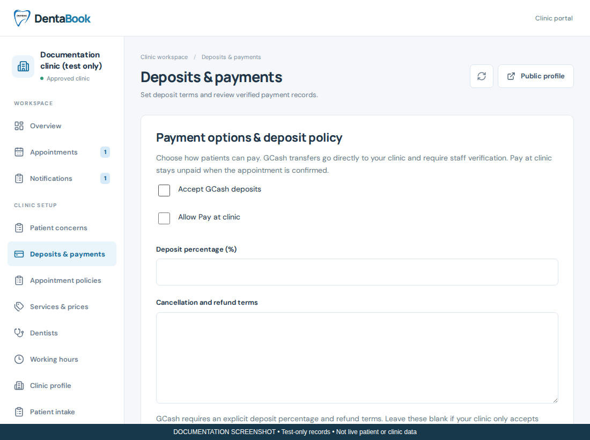

### 12. Set appointment policies and review change requests

1. Open **Appointment policies**. Enable **Allow patient cancellation** and/or **Allow patient reschedule requests** as appropriate.
2. Set the whole-hour notice periods, enter **Appointment change terms**, then choose **Save appointment policy**. Explain deposit consequences consistently with the payment terms; the website does not automatically refund or forfeit deposits.
3. Under **Appointments**, choose the **Reschedule requests** status and open a relevant appointment. In **Changes & cancellation**, choose **Review reschedule**.
4. Select **Approve replacement time** or **Decline and keep original visit**, enter **Decision note**, and choose **Save reschedule decision**. Approval rechecks availability; a conflict preserves the original visit.
5. For a staff cancellation, open **Changes & cancellation → Cancel appointment**, record a reason and confirm. Check **Change history** and any payment/refund review flag.

Dentist accounts do not administer appointment-change decisions. Confirm the selected patient/reference before each action.

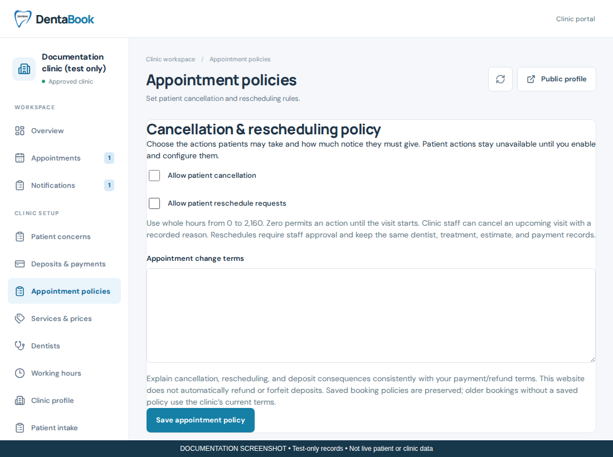

### 13. Configure intake and send appointment follow-up

1. Open **Patient intake**. Enter **Why you collect these answers** and **Your record-retention policy** before enabling intake.
2. Choose **Add intake question**. Enter **Question text**, choose written or yes/no/unsure answers, select **All treatments** or a clinic treatment, and choose whether an answer is required. Remove unwanted unsaved questions with their removal action.
3. Select **Enable patient intake** and choose **Save intake settings**. Patients see applicable questions before booking; changes do not rewrite previous saved submissions.
4. Open the appointment's details and read **Patient intake & follow-up** and saved submissions.
5. Enter **Request information from patient** and choose **Request information**. The patient responds from that appointment; refresh/reopen its details to read the saved reply.

The retention statement explains the clinic's policy; entering it does not automatically delete records. Appointment follow-up and intake do not alter payment/appointment status and are not emailed or texted.

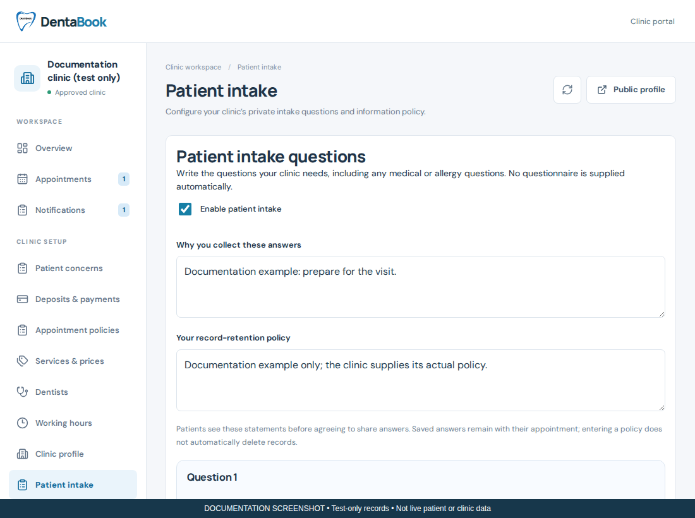

### 14. Reassign, close, moderate, or restore a concern

1. Open **Patient concerns → Open conversation** for the correct patient. Read the assignment, status and conversation.
2. Under **Manage concern**, choose **Close conversation**, **Mark as spam**, or **Reopen conversation**. Enter **Reason (shared with patient)** and choose **Save concern action**.
3. An owner/manager can choose **Reassign dentist**, select an active dentist in this clinic, enter a reason and save. The former dentist loses access; the patient sees the new assignment.
4. For repeated abuse, an owner/manager can choose **Restrict patient concerns for 24 hours**, record the reason, and save. Use **Remove restriction** to reverse an incorrect restriction.
5. Review the saved author/time/reason in the conversation. Reopening must respect the one-open-concern-per-patient-per-clinic rule.

Restrictions apply only to concerns/replies at this clinic, not appointment booking or other clinics. A dentist can manage only assigned concerns; an unassigned concern must be accommodated before the dentist replies.

### 15. Maintain staff memberships and invitations

1. The owner opens **Staff access** and reviews **Staff members**, **Invitations**, and **Staff access history**.
2. Change a member's access selector to update permissions. For an existing dentist member, use the linked-dentist selector to change the active profile they may access.
3. Choose **Remove access for …** to revoke membership. Existing sessions cannot continue using removed access.
4. Under **Invitations**, choose **Revoke invitation for …** to invalidate an unused invitation. A replacement invitation for the same email invalidates its previous unused link.
5. Review whether invitations are accepted, revoked, expired or awaiting acceptance. Only the invited identity may accept a valid link once. A clinic-staff identity with an existing password uses that password; patient/admin identities cannot be converted by an invitation.

Do not post private invitation links or account passwords in GitHub. Manager/appointment-staff permissions are separate from the owner; only the owner administers staff.

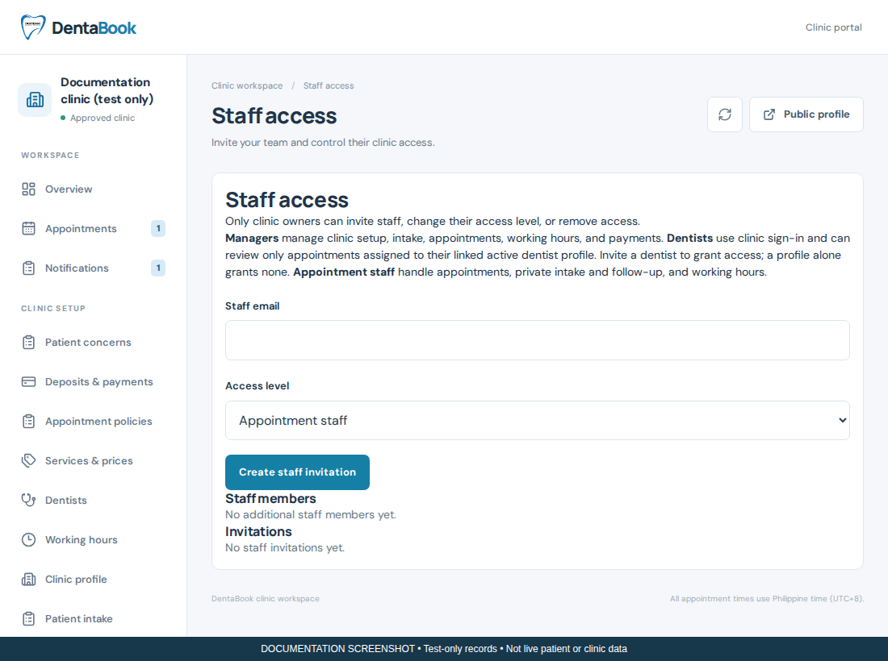

### 16. Use clinic notifications, filters and saved records

1. Open **Notifications** to see authorized new concerns, patient replies and concern updates. A linked dentist sees unassigned open concerns and their own assigned concerns.
2. Choose **Open concern** to inspect the correct conversation, **Mark as read** for one notification, or **Mark all as read** for the authorized inbox. A colleague's read status remains separate.
3. Use **Previous notifications**, **Next notifications**, and **Refresh notifications**. Counts/lists refresh while visible every 30 seconds and on focus.
4. In **Appointments**, choose the status filter and use search for loaded patient, treatment, dentist or reference information. **Refresh requests** reloads saved decisions. Search covers the loaded records; the current list is the latest 100 per status.
5. Reopen a completed visit to read private feedback and completion author/time. Sign out when finished. A patient/clinic account cannot use the administrator portal.

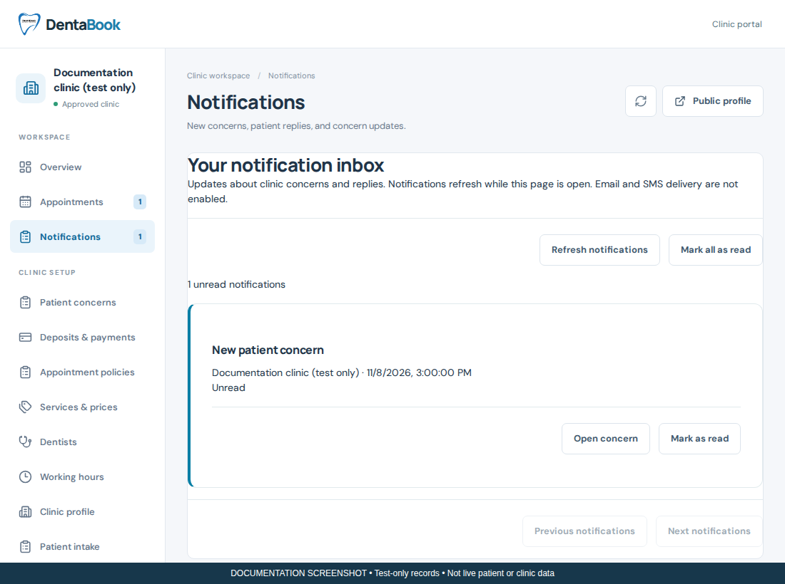

## Administrator guide

### Administrator account

| Item | Details |
| --- | --- |
| Sign-in website | [Open administrator sign-in](https://dentabook-admin.forgroup.space/admin/sign-in) |
| Administrator username or email | Provided privately by the authorized website operator |
| Password | Supplied privately by the authorized operator; not published in this repository |
| Account role | Server-validated `system_admin`; patient and clinic accounts cannot enter administration |

The username/email identifies the intended administrator account; it does not grant access without its private password. If the account has not yet been provisioned, the hosting operator follows [First administrator](docs/04_SETUP_AND_DEPLOYMENT.md#first-administrator). There is no public administrator registration or automatic default password.

### 1. Use the separate administrator website

1. Open [Administrator sign-in](https://dentabook-admin.forgroup.space/admin/sign-in).
2. Use the administrator username/email and password supplied privately by the website operator. Use **Show**/**Hide** beside the password field to check or conceal the entry. There is no public administrator registration or default password in this guide.
3. Patient and clinic accounts cannot enter the administrator portal.

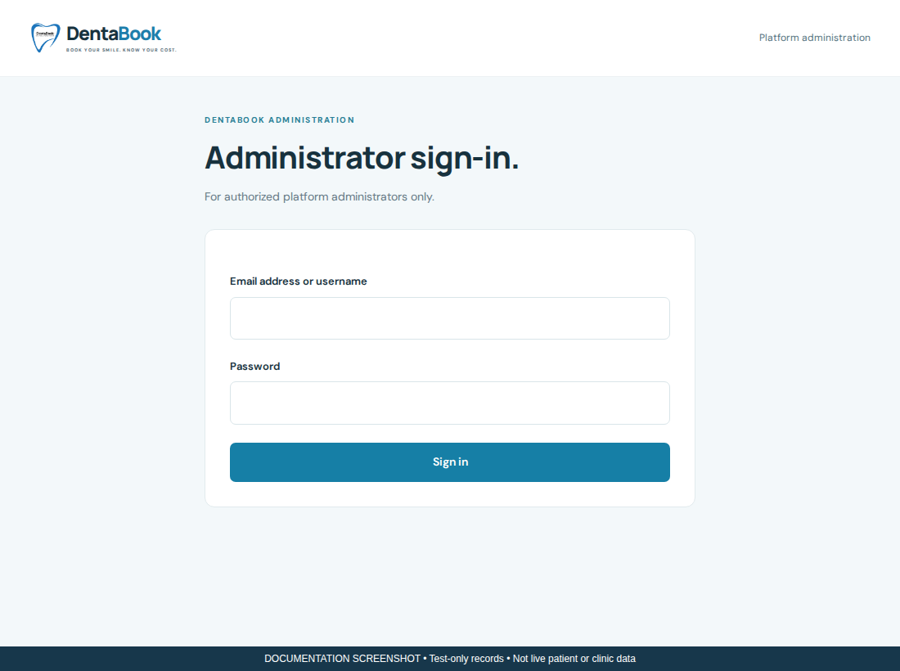

### 2. Review clinic registrations

1. Open the registration review page and select **Awaiting review** under **Registration status**.
2. Inspect the submitted clinic details, owner contact, and registration reference. Perform your organization's verification before deciding.
3. Select **Approve clinic** or **Reject registration** to open the decision confirmation.

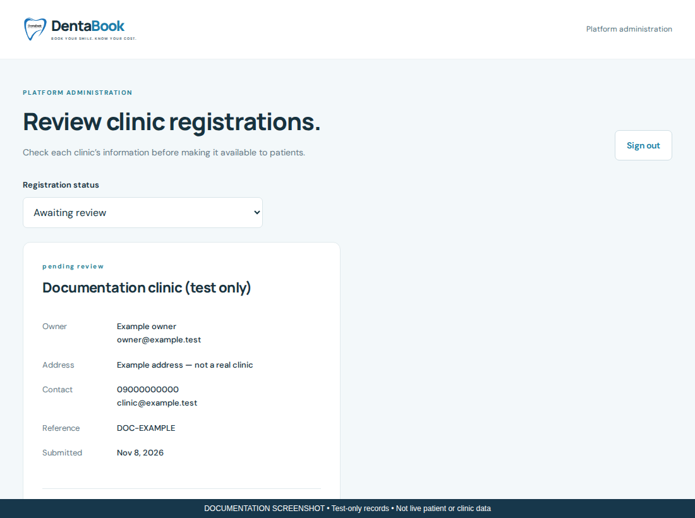

### 3. Confirm the decision and check the result

1. Read the confirmation screen. Add review notes; a rejection requires a reason.
2. Choose **Confirm decision**. Approval publishes the clinic and unlocks its workspace; rejection keeps it unpublished and shows the clinic your notes.
3. Select **Approved** or **Rejected** in the status filter to find the reviewed record. **Suspended** is a view filter, not an action to suspend a clinic.
4. Use the refresh/retry control if a request fails and check the saved result before repeating a decision. Review applies to registrations still awaiting review; an already-reviewed record cannot be overwritten through that pending-review action.
5. Choose **Sign out** when finished.

The current administrator interface reviews pending registrations. It does not provide a complete suspension-management workflow, patient clinical workspace, or clinic payment workspace.

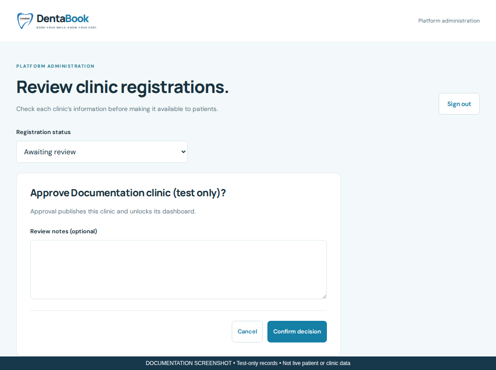

## More information

| Looking for… | Open |
| --- | --- |
| Full user instructions | [User guide](docs/02_USER_GUIDE.md) |
| Live features, limitations, next work and website addresses | [Feature and release status](docs/FEATURE_STATUS.md) |
| Short website release notes | [Website updates](CHANGELOG.md) |
| Full website history | [Website history](docs/12_DEVELOPMENT_HISTORY.md) |
| Printable handbook | [PDF](https://github.com/TradsKraken/DentaBook_Client/blob/main/CLIENT_GUIDE.pdf) · [HTML](CLIENT_GUIDE.html) |
| Setup, operations, API and security references | [Documentation library](docs/README.md) |
| Source and release verification | [Verification record](docs/VERIFICATION.md) |

This guide documents live features released through **8 November 2026**. Screenshots are explanatory test fixtures, not clinic recommendations or price quotations. Reading this repository does not require a technical setup; use the live website links above. Installation instructions are available separately for the website operator.
