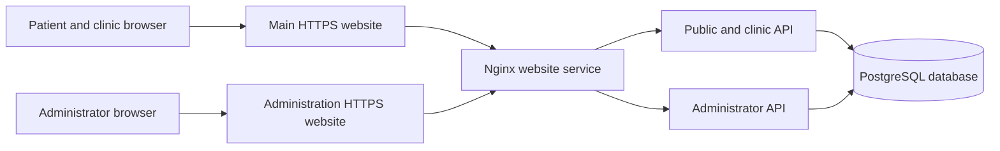

# Technical overview

## How the website is organized

DentaBook has three application layers: the browser interface, the server API, and the database. Production runs the API in two processes so administrator access is separated from the public and clinic site.

The browser presents forms and pages. The API validates submitted information and enforces account permissions. PostgreSQL stores the records. A browser cannot gain administrator access by changing a page link, form value, or request header.

## Technologies used

| Technology | Purpose |
| --- | --- |
| React 19 | Builds the website's reusable interface components |
| React Router 7 | Connects page addresses to the correct interface and handles navigation |
| Vite 6 | Runs the frontend development server and builds deployable website files |
| Standard CSS | Provides the mobile-first layout, theme, controls, and transitions |
| Lucide React | Supplies interface icons |
| Node.js 22 | Runs the server application and build tools |
| Express 4 | Organizes API requests and server middleware |
| node-postgres (`pg`) | Connects the server to PostgreSQL using pooled connections |
| PostgreSQL 16 | Stores accounts, clinic information, sessions, and related records |
| bcrypt 6 | Hashes passwords before they are stored |
| Nginx | Serves built website files and forwards API requests |
| Docker and Docker Compose | Package the services and define how they run together |
| Playwright | Checks browser behavior and responsive layouts |
| PGlite | Runs isolated PostgreSQL-compatible integration tests |

Exact installed package versions are recorded in both lockfiles and summarized in [dependency versions](DEPENDENCIES.md). Package ranges in `package.json` describe allowed versions; `npm ci` installs the lockfile versions.

## Main source files

| Location | Responsibility |
| --- | --- |
| `client/src/App.jsx` | Website routes and public/clinic/admin page layouts |
| `client/src/pages/` | Public pages, registration, sign-in, and workspaces |
| `client/src/hooks/useAuth.jsx` | Browser session loading and access-related navigation |
| `client/src/hooks/useClinics.jsx` | Loading approved public clinic information |
| `client/src/api.js` | Requests from the browser to the same website's API |
| `client/src/index.css` | Branding, responsive layout, forms, and touch controls |
| `server/routes/` | Account, clinic directory, and workspace endpoints |
| `server/auth.js` | Session validation, password-related access controls, and role checks |
| `server/portal.js` | Restricts which roles and endpoints each API process accepts |
| `server/database/` | Initial schema and ordered database migrations |
| `client/nginx-portals/` | Production public/admin listeners and forwarding rules |

## How information moves through the system

When a visitor opens the clinic directory, the browser requests `/api/clinics`. The API reads approved clinics and their active public services and dentist information. It returns data for the interface to display. If the query fails, the page shows a loading error rather than an invented clinic listing.

When a patient or clinic representative signs in, the server checks the password hash and required role. It creates a random session token, stores only its hash, and places the token in a protected browser cookie. Each private request is checked against the saved session. Authentication uses database-backed opaque sessions; it does not use JWT tokens.

When an administrator reviews a registration, the administrator API checks the session and role before changing a pending clinic's status. The change is saved with the reviewer and review information. Public directory queries only include approved clinics.

## Implementation approach

The application is organized into incremental capabilities: public discovery, account registration and permissions, clinic review, production separation, and testing. Interfaces use actual API data and explicit states for incomplete operations. Database changes are applied through versioned migration files rather than relying on manual changes to every installation.

The next increments extend clinic data management and scheduling before enabling appointment submission. The [development plan](06_STATUS_AND_DEVELOPMENT_PLAN.md) explains this order and its acceptance criteria.
