# Status and development plan

**Snapshot: 31 October 2026.** This document distinguishes delivered behavior from remaining scope. A database table or page address alone does not mean its complete workflow is available.

For earlier milestones and how the project reached this stage, read the [development history](12_DEVELOPMENT_HISTORY.md), beginning with the first recorded work on 29 October 2026.

## Delivered in this snapshot

| Area | Available behavior |
| --- | --- |
| Public website | Homepage, treatment information, about page, and phone-first navigation |
| Clinic discovery | Approved-clinic directory, search, public clinic details, active services, and active dentist information |
| Cost estimates | Selected clinic's published prices; no charge or booking is created |
| Patient accounts | Registration, sign-in/out, account information, private-page protection |
| Patient appointments | Account-scoped reading of existing linked records, including an empty state |
| Clinic accounts | Registration, pending/rejected/suspended status information, review notes, and approved-clinic workspace |
| Administrator review | Separate sign-in and pending-clinic approval/rejection with recorded reviewer and notes |
| Access controls | Hashed passwords, database-backed sessions, role and ownership checks, origin checks, and separate administration |
| Hosting | Docker services, persistent storage, HTTPS proxy configuration, and deployment instructions |
| Verification | Automated backend and browser checks, including 320/390/768/1440px layouts |

## Current development position

The discovery and account foundation is delivered. The next proposed product increment is **clinic content management**. The remaining items below are planned or not implemented; they are not being presented as working features or as started tasks. Move an item to active development only when it has an assigned owner and work has begun. Update this document at each release.

The [planned booking diagram](11_DIAGRAMS_AND_WORKFLOWS.md) shows how the future steps fit together; it is not a live booking workflow.

## Remaining phases and completion criteria

| Order | Work | Prerequisite or client decision | Complete when |
| --- | --- | --- | --- |
| 1 | Clinic profile, service/price, and dentist editing | Confirm editable fields, publication rules, and credential handling | Approved clinic staff can save their own records; unauthorized edits are rejected; public views show the saved changes |
| 2 | Dentist-service assignments and schedules | Confirm working hours, appointment durations, timezone, and closure rules | Availability is derived from saved schedules and assignments, with invalid overlaps rejected |
| 3 | Persistent appointment requests | Finish schedule rules and patient intake fields | Signed-in patients can submit valid requests; concurrent conflicts are prevented in database transactions; requests survive reloads |
| 4 | Clinic appointment review | Agree acceptance/decline rules and responsibilities | Authorized clinics can review only their own requests and patients can see the saved outcomes |
| 5 | Deposits and payment confirmation | Select payment provider, deposit policy, refund process, and operator accounts | Provider-confirmed callbacks are verified, duplicate events are safe, amounts are checked on the server, and payment records reconcile |
| 6 | Cancellation, rescheduling, and notifications | Agree notice periods, allowed transitions, and delivery channels | Permitted changes are saved consistently and authorized recipients receive the correct notifications |
| 7 | Completed-visit feedback | Agree moderation and eligibility rules | Only eligible completed visits can receive feedback and publication follows the agreed policy |
| 8 | Account recovery and operational strengthening | Select email delivery, recovery procedures, backup ownership, and MFA scope | Recovery and verification are tested; scheduled backups and restore checks operate; required monitoring and controls are documented |

Each phase includes phone testing, access-control checks, real database persistence, failure handling, and updated documentation. Dates and effort estimates should be agreed after reviewing the phase's detailed requirements and dependencies.

## Decisions still needed

The next planning discussion should confirm who maintains clinic content, which credentials/documents may be stored, schedule and booking rules, deposit/refund policies, payment provider access, notification channels, backup retention, and the named operational owner. These decisions affect the design of the remaining workflows.

## Release workflow

1. Agree the phase scope and acceptance criteria.
2. Implement and test in the development environment.
3. Review the behavior with the project owner on phone and desktop.
4. Prepare an approved client release with updated status and release notes.
5. Back up production, deploy deliberately, and complete acceptance checks.
6. Record the deployed version and operational handover.

The client repository receives reviewed release snapshots. Changes in the development repository do not deploy to production or update client releases automatically.
