# Diagrams and workflows

These diagrams explain the delivered application and the remaining development plan. **Current** means available behavior or an existing schema/process. **Planned** means not implemented. A schema diagram describes stored relationships, not a promise that the corresponding management screens exist.

Blue boxes represent current behavior. Dashed amber boxes explicitly marked PLANNED describe future work. Grey boxes mark an unavailable operation or a boundary. Labels preserve these meanings when printed without color.

On a phone, open an SVG at full size to zoom. In the HTML handbook, wide diagrams have their own scroll area. All diagrams are included as vector images for clear printing, with editable Mermaid sources alongside them.

## Diagram index

| Diagram | Status | Main question answered |
| --- | --- | --- |
| [System architecture](diagrams/01-system-architecture.svg) | Current deployment | The public hostname is dentabook.forgroup.space; administration uses dentabook-admin.forgroup.space |
| [Patient browsing and account workflow](diagrams/02-patient-workflow.svg) | Current workflow | Visitors do not need an account to browse or estimate costs |
| [Clinic registration and access](diagrams/03-clinic-registration.svg) | Current workflow | Registration and staff-account creation are one database transaction |
| [Administrator review process](diagrams/04-administrator-review.svg) | Current workflow | The review API permits only pending-to-approved or pending-to-rejected changes |
| [Sign-in and session creation](diagrams/05-session-and-permissions.svg) | Current sequence | Only the hash of the random session token is stored |
| [Private request permissions](diagrams/12-private-access-checks.svg) | Current sequence | A valid session still needs role, ownership, and clinic-approval checks |
| [Accounts, clinics, and public data](diagrams/06-core-data-relationships.svg) | Current schema | This is a simplified view of actual foreign keys, not every column |
| [Appointment and payment data foundations](diagrams/07-appointment-data-relationships.svg) | Existing schema; management workflows planned | The tables already exist, but they do not establish a working booking or payment feature |
| [Future appointment workflow](diagrams/08-planned-booking-workflow.svg) | Planned; not a live booking process | Dashed amber steps are proposed development, not available features |
| [Reviewed releases and deployment](diagrams/09-release-and-deployment.svg) | Current manual operating process | This is an operator-led process, not automatic deployment |
| [Remaining development phases](diagrams/10-development-roadmap.svg) | Foundation delivered; next phases planned | The order follows the development plan |
| [Published-price cost estimation](diagrams/11-cost-estimate-flow.svg) | Current workflow | The calculator reads published database prices but performs the informational total in the browser |

## System architecture

**Status: Current deployment.**


The public hostname is dentabook.forgroup.space; administration uses dentabook-admin.forgroup.space. Both APIs share the production database. HTTPS terminates at the external proxy; the upstream LAN links use HTTP. The APIs and database have no published production ports.

[Open full-size SVG](diagrams/01-system-architecture.svg) · [Editable Mermaid source](diagrams/src/01-system-architecture.mmd)

## Patient browsing and account workflow

**Status: Current workflow.**


Visitors do not need an account to browse or estimate costs. Personal pages require a server-validated patient session. Existing appointment records can be read; new booking submission is not implemented.

[Open full-size SVG](diagrams/02-patient-workflow.svg) · [Editable Mermaid source](diagrams/src/02-patient-workflow.mmd)

## Clinic registration and access

**Status: Current workflow.**


Registration and staff-account creation are one database transaction. Signing in while pending does not grant approved-clinic access. A suspended status can also be displayed, but a complete suspension-management interface is not delivered.

[Open full-size SVG](diagrams/03-clinic-registration.svg) · [Editable Mermaid source](diagrams/src/03-clinic-registration.mmd)

## Administrator review process

**Status: Current workflow.**


The review API permits only pending-to-approved or pending-to-rejected changes. The software records a publishing decision; professional-license verification remains an administrator responsibility.

[Open full-size SVG](diagrams/04-administrator-review.svg) · [Editable Mermaid source](diagrams/src/04-administrator-review.mmd)

## Sign-in and session creation

**Status: Current sequence.**

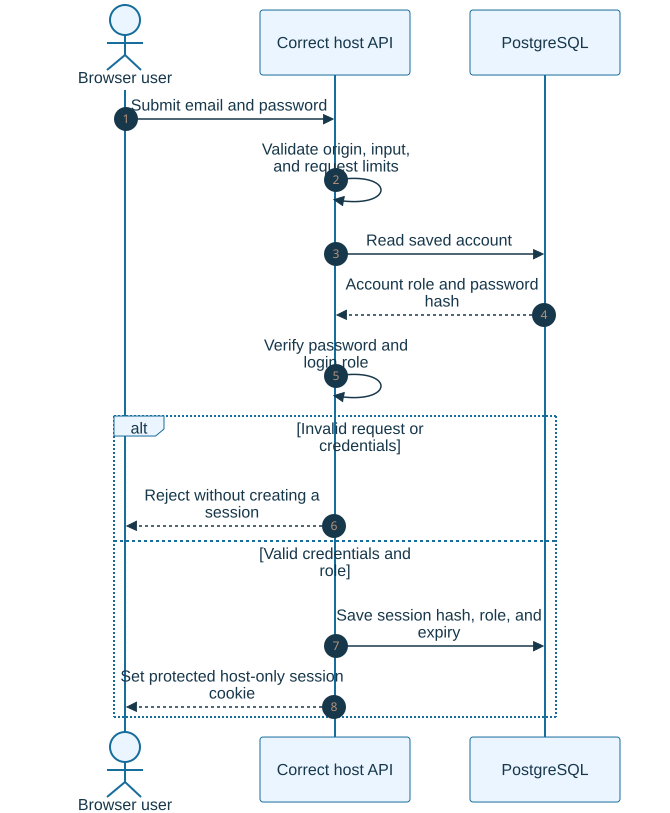

Only the hash of the random session token is stored. Administrator sessions last one hour; patient and clinic sessions last eight hours. Logout, expiry, password-hash changes, or role changes revoke access as described in the security guide.

[Open full-size SVG](diagrams/05-session-and-permissions.svg) · [Editable Mermaid source](diagrams/src/05-session-and-permissions.mmd)

## Accounts, clinics, and public data

**Status: Current schema.**


This is a simplified view of actual foreign keys, not every column. Clinic ownership may be empty at database level; workspace access still requires the signed-in owner and approval. reviewed_by also refers to a user. Public queries filter approved clinics and active dentist/service records.

[Open full-size SVG](diagrams/06-core-data-relationships.svg) · [Editable Mermaid source](diagrams/src/06-core-data-relationships.mmd)

## Appointment and payment data foundations

**Status: Existing schema; management workflows planned.**


The tables already exist, but they do not establish a working booking or payment feature. Only reading existing patient-linked appointments is available. Appointment creation, payment integration, and review submission remain planned. The appointment foreign keys point to users, clinics, and dentists; the service-line foreign key points to services, shown in the preceding core-data diagram. Those parent entities and scheduling/assignment tables are omitted here for readability; see the schema for the full structure.

[Open full-size SVG](diagrams/07-appointment-data-relationships.svg) · [Editable Mermaid source](diagrams/src/07-appointment-data-relationships.mmd)

## Future appointment workflow

**Status: Planned; not a live booking process.**


Dashed amber steps are proposed development, not available features. The client must agree scheduling, deposits, cancellation, notification, and feedback rules before implementation. Signing in today does not create a request or collect payment.

[Open full-size SVG](diagrams/08-planned-booking-workflow.svg) · [Editable Mermaid source](diagrams/src/08-planned-booking-workflow.mmd)

## Reviewed releases and deployment

**Status: Current manual operating process.**


This is an operator-led process, not automatic deployment. Development changes do not update production or the client repository by themselves. Database migrations have no general automatic down command; recovery must account for both code and data.

[Open full-size SVG](diagrams/09-release-and-deployment.svg) · [Editable Mermaid source](diagrams/src/09-release-and-deployment.mmd)

## Remaining development phases

**Status: Foundation delivered; next phases planned.**

The order follows the development plan. These are proposed release phases, not start dates or a claim that work has already begun. Operational responsibilities and backups apply throughout, even where future automation appears later in the roadmap.

[Open full-size SVG](diagrams/10-development-roadmap.svg) · [Editable Mermaid source](diagrams/src/10-development-roadmap.mmd)

## Published-price cost estimation

**Status: Current workflow.**


The calculator reads published database prices but performs the informational total in the browser. It is not a payment amount authorization or a final treatment quote.

[Open full-size SVG](diagrams/11-cost-estimate-flow.svg) · [Editable Mermaid source](diagrams/src/11-cost-estimate-flow.mmd)

## Private request permissions

**Status: Current sequence.**

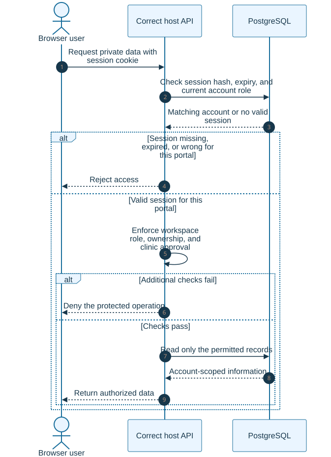

A valid cookie alone does not authorize every action. The API checks session expiry, account role, the configured public/admin process, and the workspace's rules. Patient records are restricted to the signed-in patient; clinic information is restricted to the owner and approval status. Related database reads needed for approval and ownership are grouped within the permission checks in this overview.

[Open full-size SVG](diagrams/12-private-access-checks.svg) · [Editable Mermaid source](diagrams/src/12-private-access-checks.mmd)
