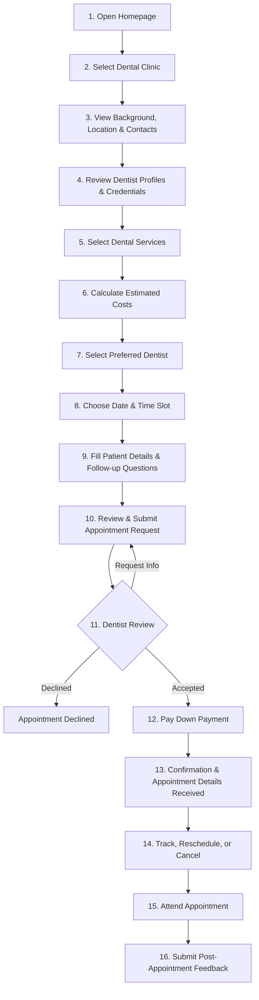

# Patient / Customer Journey & Workflow

This document details the complete 18-step end-to-end journey for patients utilizing the DentaBook platform.

---

---

## Detailed Step-by-Step Breakdown

### Phase 1: Discovery & Evaluation
1. **Homepage Arrival**: Customer lands on the DentaBook portal and searches for clinics by location or service.
2. **Clinic Selection**: Customer selects a clinic of interest from the directory.
3. **Clinic Background & Contact**: Customer inspects the clinic's facilities, physical address, map location, and operating hours.
4. **Dentist Credentials**: Customer reviews dentist qualifications, specializations, licenses, and background information.
5. **Service Selection**: Customer browses through the specific dental treatments offered by the chosen clinic.

### Phase 2: Cost Estimation & Slot Selection
6. **Cost Calculator**: Customer selects one or multiple dental procedures to compute the estimated aggregate treatment cost.
7. **Dentist Assignment**: Customer picks their preferred dentist who is qualified for the chosen procedures.
8. **Date Selection**: Customer selects an available appointment date from the interactive calendar.
9. **Time Slot Selection**: Customer selects an unoccupied time slot corresponding to the dentist's working hours.

### Phase 3: Booking Request Submission
10. **Information Intake**: Customer provides essential personal details (Full name, contact phone, email address, age/notes).
11. **Follow-Up Questions**: Customer answers pre-screening questions (e.g., medical allergies, existing dental pain, last dental visit).
12. **Review & Submission**: Customer verifies all entered appointment details and submits the request to the clinic.

### Phase 4: Clinic Review & Down Payment
13. **Dentist Review**: The clinic/dentist reviews the appointment request and selects: **Accept**, **Decline**, or **Request More Information**.
14. **Down Payment Processing**: Upon acceptance, the customer is prompted to pay the required security down payment to lock in the reservation.
15. **Appointment Confirmation**: System validates the down payment and issues formal confirmation.
16. **Confirmation Delivery**: Customer receives confirmed date, time, clinic address, and booking reference via email/portal notification.

### Phase 5: Post-Booking & Follow-up
17. **Appointment Management**: Customer can track real-time status, request a reschedule, or cancel in accordance with the clinic's cancellation policy.
18. **Review & Feedback**: Following completion of the dental visit, the customer is invited to rate the service and provide feedback.
