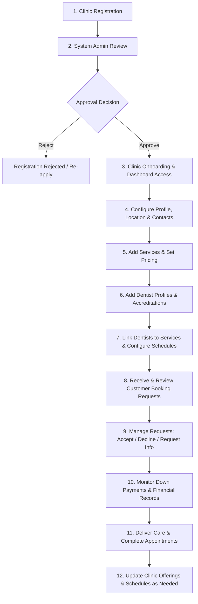

# Clinic & Administration Workflow

This document specifies the operational lifecycle for dental clinics and platform administrators on DentaBook.

---

---

## Detailed Step-by-Step Breakdown

### Phase 1: Onboarding & Verification
1. **Clinic Account Registration**: Clinic submits an onboarding application with business details, license numbers, clinic name, and owner credentials.
2. **Platform Admin Verification**: A platform super-admin audits the submitted documentation to maintain healthcare compliance and platform trust.
3. **Approval & Activation**: Once verified, the clinic receives official confirmation and credentials to access their management portal.

### Phase 2: Configuration & Service Catalog Setup
4. **Clinic Profile Setup**: Clinic administrators upload logo/photos, set clinic bio, input physical location/directions, and establish public contact channels.
5. **Service & Pricing Configuration**:
   - Add dental treatments (e.g., Cleaning, Root Canal, Orthodontics, Extraction).
   - Set base prices, duration estimates, and down-payment requirements.
6. **Dentist Roster & Qualifications**:
   - Create staff profiles for licensed dentists and hygienists.
   - Attach degrees, certifications, years of experience, and specialty tags.
7. **Service Mapping & Availability Schedules**:
   - Link specific dentists to the dental services they are authorized to perform.
   - Define weekly working hours, shift schedules, vacation dates, and appointment slot buffers.

### Phase 3: Daily Operations & Appointment Management
8. **Live Appointment Ingestion**: Clinic and dentists receive real-time notifications when prospective patients submit booking requests.
9. **Request Evaluation**: Dentists evaluate patient answers to pre-screening questions and either approve the slot, reject it with reasoning, or request clarifying details.
10. **Payment & Deposit Tracking**: Clinic tracks incoming reservation deposits, pending balances, and confirmed booking vouchers.
11. **Appointment Completion**: Clinic marks visits as completed, records internal clinical notes, and tracks patient attendance status.

### Phase 4: Maintenance & Scalability
12. **Ongoing Catalog Adjustments**: Clinic staff dynamically adjust pricing, add seasonal promotions, update schedule availability, or register new dentists as the practice expands.
