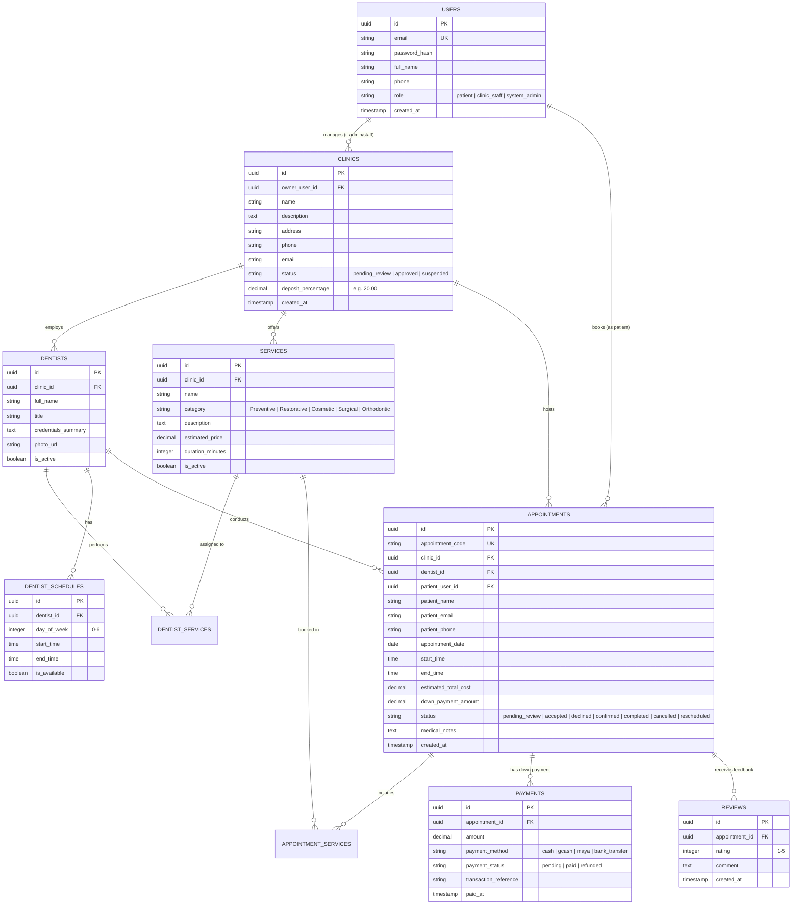

# DentaBook - System & Technology Architecture

This document defines the technical architecture for the **DentaBook** dental clinic appointment and pricing platform. It is adapted from the proven stack of the previous project, streamlined and tailored specifically for DentaBook's requirements, and designed for containerized deployment via Docker.

---

## 1. System Overview & Container Architecture

DentaBook runs as a **3-tier containerized stack** orchestrated with Docker Compose:

```mermaid
flowchart TD
    subgraph Users [Client Browsers]
        Patient[Patient / Public User]
        ClinicStaff[Clinic Staff / Dentist]
        SysAdmin[System Admin]
    end

    subgraph DockerHost [Docker Compose Environment: dentabook-network]
        subgraph WebContainer [Service: client (Nginx)]
            Nginx[Nginx Reverse Proxy & Static File Server<br/>Port 80]
            ReactApp[React + Vite Single-Page Application<br/>- Patient Portal<br/>- Clinic Dashboard<br/>- Admin Verification]
        end

        subgraph BackendContainer [Service: api (Node.js)]
            Express[Express 4 Application<br/>Port 5000]
            AuthModule[JWT & Cookie Auth / RBAC]
            CalculatorEngine[Treatment Cost Estimator Logic]
            BookingEngine[Slot Conflict & Reservation Engine]
        end

        subgraph DBContainer [Service: db (PostgreSQL 16)]
            Postgres[(PostgreSQL Database<br/>Port 5432)]
            Volume[(Persistent Volume: dentabook_pgdata)]
        end
    end

    Patient -->|HTTP / HTTPS: Port 3000| Nginx
    ClinicStaff -->|HTTP / HTTPS: Port 3000| Nginx
    SysAdmin -->|HTTP / HTTPS: Port 3000| Nginx

    Nginx -->|Serves Static Files| ReactApp
    Nginx -->|Proxies /api/* requests| Express
    Express -->|SQL Queries & Transactions| Postgres
    Postgres --> Volume
```

---

## 2. Technology Stack Selection

### 2.1. Frontend
* **Core Framework**: **React 19 / 18** with **Vite** for ultra-fast build times and modern component development.
* **Routing**: **React Router DOM 7 / 6** with client-side route guards for three role tiers:
  - Public / Patient routes (`/`, `/clinics`, `/clinics/:id`, `/calculator`, `/book`, `/my-appointments`)
  - Clinic Management routes (`/clinic/dashboard`, `/clinic/services`, `/clinic/dentists`, `/clinic/schedule`, `/clinic/appointments`)
  - Platform Administrator routes (`/admin/dashboard`, `/admin/clinics/approval`)
* **Styling & UI**: Modern Responsive CSS / CSS Variables (mobile-first, touch-friendly, optimized for phone browsers as well as desktop screens).
* **Icons**: **`lucide-react`** (clean dental, calendar, clock, payment, and user icons).
* **Delivery Engine**: **Nginx Alpine** multi-stage Docker build serving static files and reverse-proxying `/api` traffic to the backend.

### 2.2. Backend
* **Runtime & Framework**: **Node.js 22** + **Express 4**.
* **Database Driver**: **`pg` (node-postgres)** utilizing pooled connections and ACID transactions for appointment locking.
* **Authentication**: **`bcrypt`** (password hashing) + signed **JWT tokens** stored in `HttpOnly`, `SameSite=Strict` secure cookies.
* **Role-Based Access Control (RBAC)**: Middleware enforcing permissions for `patient`, `clinic_staff`, and `system_admin`.
* **File Uploads**: **`multer`** for handling clinic photos and dentist credential uploads.

### 2.3. Database
* **Engine**: **PostgreSQL 16 Alpine**.
* **Storage**: Persistent Docker volume (`dentabook_pgdata`) mounted to `/var/lib/postgresql/data`.
* **Integrity**: Strong relational constraints (Foreign Keys, Unique slot constraints, Cascades, and Indexes on dates and clinic IDs).

---

## 3. What Was Adopted vs. What Was Omitted From Previous Architecture

| Area | In Previous Project (Fortek) | DentaBook Architecture | Rationale for DentaBook |
| :--- | :--- | :--- | :--- |
| **Frontend Structure** | 2 separate apps (Storefront + POS) on separate ports (3000 & 3002) | **1 unified Single-Page App** with protected role-based layouts on Port 3000 | Simplifies deployment, maintenance, and student presentation. Patients and clinic staff share one clean domain/port with role-based routing. |
| **Backend & DB** | Node.js + Express + PostgreSQL with raw SQL | **Node.js + Express + PostgreSQL** with structured schema migrations | Retains the exact same proven, fast, reliable database stack. |
| **Finance / Accounting** | Firefly III / Waterfly integration with AES-256 tokens | **Omitted** | DentaBook only needs simple deposit/down payment tracking, not double-entry external ledger syncing. |
| **Workflow Automation** | n8n webhook integrations | **Omitted** | Unnecessary external complexity for this project scope. |
| **Inventory / Stocking** | Multi-batch FIFO costing, defect tracking, supplier purchase orders | **Omitted** | Replaced with Dental Clinic Services catalog, dentist assignment, and time-slot scheduling. |
| **Container Hosting** | Docker Compose with multi-stage Nginx builds | **Retained & Streamlined** to 3 core services (`client`, `api`, `db`) | One-command server setup (`docker compose up -d --build`). |

---

## 4. Database Schema Blueprint



---

## 5. Docker Deployment Configuration Blueprint

### Docker Compose Architecture (`docker-compose.yml`)

The production deployment will consist of:

1. **`client` Service**:
   - Built via multi-stage `Dockerfile`:
     - Stage 1: `node:22-alpine` runs `npm run build` with Vite.
     - Stage 2: `nginx:alpine` copies `/dist` to `/usr/share/nginx/html`.
   - Nginx handles SPA history routing (fallback to `index.html`) and proxies `/api/` traffic directly to `http://api:5000`.
   - Published Port: `3000:80` (or reverse proxied by server's public web server/Cloudflare).

2. **`api` Service**:
   - Built via `node:22-alpine` `Dockerfile`.
   - Connects to internal PostgreSQL container `db:5432`.
   - Listens on internal port `5000`.
   - Health check: `curl -f http://localhost:5000/api/health || exit 1`.

3. **`db` Service**:
   - Official image: `postgres:16-alpine`.
   - Volume: `dentabook_pgdata:/var/lib/postgresql/data`.
   - Internal port: `5432` (loopback only on host if debugging is needed).
   - Auto-executes SQL initialization scripts mounted at `/docker-entrypoint-initdb.d/`.

### Deployment Command:
```bash
docker compose up -d --build
```

---

## 6. Implementation Readiness Checklist

- [x] Client workflow and clinic management processes fully mapped.
- [x] Tech stack selected matching developer familiarity (React + Vite, Node + Express, PostgreSQL, Docker).
- [x] Unnecessary external services from previous project eliminated (no Firefly, no n8n, no complex FIFO inventory).
- [x] Unified single-app routing planned to simplify server hosting.
- [ ] Database schema DDL script preparation.
- [ ] Docker configuration files creation (`docker-compose.yml`, Dockerfiles, `nginx.conf`).
- [ ] Frontend & Backend scaffolding (pending user approval).

